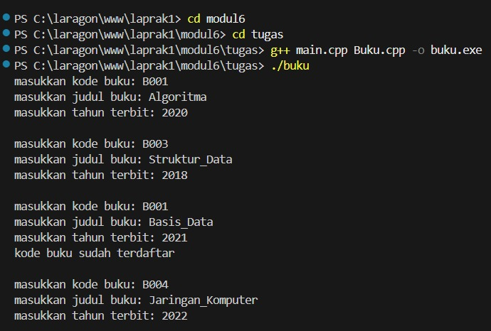
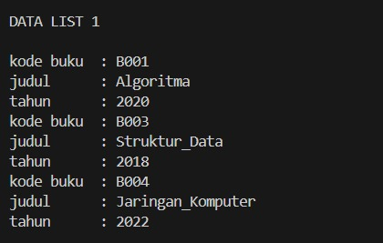
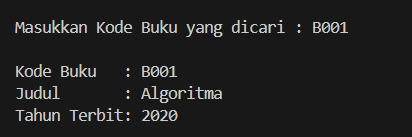
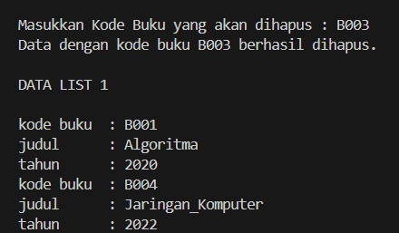

# <h1 align="center">Laporan Praktikum Modul 6 DOUBLY LINKED LIST (BAGIAN PERTAMA)</h1>
<p align="center">MUH. DZAKY LUTHFI - 109082530015</p>

## Dasar Teori

Linked list atau yang disebut juga senarai berantai adalah salah satu bentuk struktur data yang berisi kumpulan data yang tersusun secara sekuensial, saling bersambungan, dinamis, dan terbatas[1]. Linked list terdiri dari sejumlah node atau simpul yang dihubungkan secara linier dengan bantuan pointer.

### A. Doubly Linked List<br/>
Doubly Linked List adalah linked list yang masing-masing elemennya memiliki 2 successor (penunjuk), yaitu successor yang menunjuk pada elemen sebelumnya (*prev*) dan successor yang menunjuk pada elemen sesudahnya (*next*)[1]. Berbeda dengan singly linked list, doubly linked list juga menggunakan dua buah successor utama yang terdapat pada list, yaitu `first` (menunjuk elemen pertama) dan `last` (menunjuk elemen terakhir)[1]. 

#### 1. Struktur dan Komponen
Terdapat beberapa komponen utama dalam struktur data Doubly Linked List[1]:
*   **First**: Pointer pada list yang menunjuk pada elemen pertama list.
*   **Last**: Pointer pada list yang menunjuk pada elemen terakhir list.
*   **Next**: Pointer pada elemen sebagai successor yang menunjuk pada elemen di depannya.
*   **Prev**: Pointer pada elemen sebagai successor yang menunjuk pada elemen di belakangnya.

#### 2. Representasi Fisik (ADT)
Dalam implementasinya menggunakan C++, tipe data bentukan dideklarasikan menggunakan `struct`. Sebuah elemen list (ElmList) berisi `info` bertipe `infotype`, serta dua pointer yaitu `prev` dan `next`[1]. Struktur `List` sendiri menyimpan dua pointer `first` dan `last`. Kondisi list dikatakan kosong apabila `L.first = Nil`[1].

#### 3. Kelebihan
Karena memiliki pointer `prev` dan `next`, proses akses elemen pada Doubly Linked List lebih mudah karena dapat melakukan iterasi maju dan mundur, berbeda dengan Singly Linked List yang hanya bisa maju[1].

### B. Operasi Dasar pada Doubly Linked List<br/>
Terdapat beberapa operasi dasar yang dapat dilakukan pada struktur data ini, antara lain:

#### 1. Insert (Penambahan Data)
Proses menambahkan elemen baru ke dalam list. Terdapat beberapa variasi penambahan[1]:
*   **Insert First**: Menambahkan elemen baru di awal list. Pointer `next` elemen baru diarahkan ke `L.first` lama, dan `prev` elemen baru diset `Nil`.
*   **Insert Last**: Menambahkan elemen baru di akhir list. Pointer `prev` elemen baru diarahkan ke `L.last` lama, dan pointer `next` dari `L.last` lama diarahkan ke elemen baru.
*   **Insert After**: Menambahkan elemen baru setelah elemen tertentu (Prec).

#### 2. Delete (Penghapusan Data)
Proses menghapus elemen dari dalam list. Sama seperti insert, terdapat beberapa variasi penghapusan[1]:
*   **Delete First**: Menghapus elemen pertama. `L.first` dipindahkan ke elemen selanjutnya (`L.first->next`), dan pointer `prev` dari elemen baru tersebut diset `Nil`.
*   **Delete Last**: Menghapus elemen terakhir. `L.last` dipindahkan ke elemen sebelumnya (`L.last->prev`), dan pointer `next` dari elemen baru tersebut diset `Nil`.
*   **Delete After**: Menghapus elemen yang berada tepat setelah elemen tertentu (Prec). Pointer `next` dari `Prec` diarahkan ke elemen setelah elemen yang dihapus.

#### 3. Searching dan View
Proses pencarian (searching) dan penampilan data (view) pada dasarnya sama dengan proses pada Singly Linked List. Pada Doubly Linked List, pencarian dapat dilakukan dengan iterasi maju (dari `first` ke `last`) maupun iterasi mundur (dari `last` ke `first`)[1].

## Guided 

### 1. Doublylist.h

```C++
#ifndef DOUBLYLIST_H
#define DOUBLYLIST_H

#include <iostream>
#include <string>

#define Nil NULL

// Latihan 1
struct infotype {
    std::string nopol; 
    std::string warna; 
    int thnBuat;      
};
typedef struct elmlist *address;
struct elmlist {
    infotype info;  
    address next;   
    address prev;   
};
struct List {
    address First; 
    address Last;  
};


// Latihan 1
void CreateList(List &L);
address alokasi(infotype x);
void dealokasi(address &P);
void printInfo(List L);
void insertLast(List &L, address P);

// Latihan 2

address findElm(List L, std::string nopol);

// Latihan 3
void deleteFirst(List &L, address &P);
void deleteLast(List &L, address &P);
void deleteAfter(List &L, address Prec, address &P);
void deleteElm(List &L, std::string nopol, bool &status);

#endif
```
File ini mendeklarasikan struktur data dasar untuk Doubly Linked List. Terdiri dari struct infotype (data kendaraan), struct elmlist (node yang memiliki pointer next dan prev), dan struct List (menyimpan pointer First dan Last). File ini juga mendeklarasikan prototipe fungsi operasi dasar seperti pembuatan list, alokasi, insert, delete, dan pencarian.

### 2. Doublylist.cpp

```C++
#include "Doublylist.h"

// Latihan 1
void CreateList(List &L) {
    L.First = Nil;
    L.Last = Nil;
}

address alokasi(infotype x) {
    address P = new elmlist;
    P->info = x;
    P->next = Nil;
    P->prev = Nil; 
    return P;
}

void dealokasi(address &P) {
    delete P;
}

void printInfo(List L) {
    address P = L.Last;
    if (P == Nil) {
        std::cout << "List kosong." << std::endl;
        return;
    }
    while (P != Nil) {
        std::cout << "no polisi : " << P->info.nopol << std::endl;   
        std::cout << "warna     : " << P->info.warna << std::endl;   
        std::cout << "tahun     : " << P->info.thnBuat << std::endl; 
        P = P->prev;
    }
}

void insertLast(List &L, address P) {
    if (L.First == Nil) { 
        L.First = P;
        L.Last = P;
    } else {
        P->prev = L.Last;         
        (L.Last)->next = P;     
        L.Last = P;               
    }
}

// Latihan 2
address findElm(List L, std::string nopol) {
    address P = L.First;
    while (P != Nil) {
        if (P->info.nopol == nopol) {
            return P;
        }
        P = P->next;
    }
    return Nil;
}

// Latihan 3
void deleteFirst(List &L, address &P) {
    if (L.First == Nil) return;

    P = L.First; 
    if (L.First == L.Last) { 
        L.First = Nil;
        L.Last = Nil;
    } else {
        L.First = P->next;     
        (L.First)->prev = Nil; 
        P->next = Nil;         
    }
}

void deleteLast(List &L, address &P) {
    if (L.First == Nil) return;

    P = L.Last; 
    if (L.First == L.Last) { 
        L.First = Nil;
        L.Last = Nil;
    } else {
        L.Last = P->prev;      
        (L.Last)->next = Nil; 
        P->prev = Nil;         
    }
}

void deleteAfter(List &L, address Prec, address &P) {
    if (Prec == Nil || Prec->next == Nil) return;

    P = Prec->next;
    if (P == L.Last) {
        deleteLast(L, P);
    } else {
        Prec->next = P->next;     
        (P->next)->prev = Prec; 
        P->next = Nil;            
        P->prev = Nil;           
    }
}

void deleteElm(List &L, std::string nopol, bool &status) {
    address P = findElm(L, nopol);
    status = false;

    if (P != Nil) {
        if (P == L.First) {
            deleteFirst(L, P);
        } else if (P == L.Last) {
            deleteLast(L, P);
        } else {
            address Prec = P->prev;
            deleteAfter(L, Prec, P);
        }
        dealokasi(P); 
        status = true;
    }
}
```
File ini berisi implementasi logika dari fungsi-fungsi yang dideklarasikan di header. Fungsi insertLast menambahkan node di akhir list dengan mengatur ulang pointer prev dan next antar node. Prosedur printInfo menampilkan data dengan iterasi mundur dari Last ke First. Fungsi findElm melakukan pencarian berdasarkan nomor polisi. Sedangkan prosedur deleteElm berfungsi sebagai wrapper yang mencari posisi node lalu memanggil fungsi deleteFirst, deleteLast, atau deleteAfter yang sesuai untuk menghapus node tersebut dari list.

### 3. main.cpp

```C++
#include <iostream>
#include "Doublylist.h"
using namespace std;

void inputData(List &L) {
    infotype data;
    address P;

    cout << "masukkan nomor polisi: "; cin >> data.nopol;
    cout << "masukkan warna kendaraan: "; cin >> data.warna;
    cout << "masukkan tahun kendaraan: "; cin >> data.thnBuat;
    if (findElm(L, data.nopol) == Nil) {
        P = alokasi(data); 
        insertLast(L, P);  
    } else {
        cout << "nomor polisi sudah terdaftar" << endl; 
    }
}

int main() {
    List L;
    CreateList(L); 
    address P;

    // Latihan 1
    inputData(L); 
    inputData(L); 
    inputData(L); 
    inputData(L); 

    cout << "\nDATA LIST 1" << endl; 
    printInfo(L); 

    // Latihan 2
    string nopolCari;
    cout << "\nMasukkan Nomor Polisi yang dicari : "; 
    cin >> nopolCari; 
    
    P = findElm(L, nopolCari); 
    if (P != Nil) {
        cout << "Nomor Polisi : " << P->info.nopol << endl; 
        cout << "Warna        : " << P->info.warna << endl; 
        cout << "Tahun        : " << P->info.thnBuat << endl; 
    } else {
        cout << "Data dengan nomor polisi " << nopolCari << " tidak ditemukan." << endl;
    }

    // Latihan 3
    string nopolHapus;
    bool hapusBerhasil;
    cout << "\nMasukkan Nomor Polisi yang akan dihapus : ";
    cin >> nopolHapus;

    deleteElm(L, nopolHapus, hapusBerhasil); 

    if (hapusBerhasil) {
        cout << "Data dengan nomor polisi " << nopolHapus << " berhasil dihapus." << endl; 
    } else {
        cout << "Data dengan nomor polisi " << nopolHapus << " tidak ditemukan." << endl;
    }
    cout << "\nDATA LIST 1" << endl; 
    printInfo(L); 

    return 0;
}
```
File ini adalah program utama untuk menguji ADT. Program melakukan input data kendaraan dengan pengecekan duplikasi nomor polisi menggunakan findElm sebelum dimasukkan ke list. Setelah itu, program menguji fungsi pencarian data berdasarkan input pengguna, lalu menguji prosedur penghapusan data. Setelah penghapusan, program menampilkan kembali isi list untuk memverifikasi bahwa data telah berhasil dihapus.


## Unguided 

## SOAL Modul 6

### 1. Pembuatan ADT Dasar dan Insert Data
Buatlah ADT Doubly Linked List sebagai berikut di dalam file "Buku.h":
Type infotype : buku <
 kodeBuku : string
 judul : string
 thnTerbit : integer
>
Type address : pointer to ElmList
Type ElmList <
 info : infotype
 next : address
 prev : address
>
Type List <
 First : address
 Last : address
>
procedure CreateList( input/output L : List )
function alokasi( x : infotype ) -> address
procedure dealokasi( input/output P : address )
procedure printInfo( input L : List )
procedure insertLast( input/output L : List, input P : address )
Buatlah implementasi ADT Doubly Linked List pada file “Buku.cpp" dan cobalah hasil implementasi ADT 
tersebut pada file "main.cpp". Pastikan sistem melakukan pengecekan duplikasi kodeBuku sebelum 
memasukkan data baru ke dalam list.

### 2. Pencarian Elemen (Searching)
Carilah elemen dengan kode buku B001 dengan membuat fungsi baru:
fungsi findElm( L : List, x : infotype ) : address

### 3. Penghapusan Elemen (Delete)
Hapus elemen dengan kode buku B003 dengan membuat prosedur delete berikut:
procedure deleteFirst( input/output L : List, input/output P : address )
procedure deleteLast( input/output L : List, input/output P : address )
procedure deleteAfter( input Prec : address, input/output P : address )

```C++
//Buku.h
#ifndef BUKU_H
#define BUKU_H

#include <iostream>
#include <string>
using namespace std;

#define Nil NULL

/* =========================================
   SOAL 1: PEMBUATAN ADT DASAR
   ========================================= */
struct buku {
    string kodeBuku;
    string judul;
    int thnTerbit;
};

typedef buku infotype;
typedef struct ElmList *address;

struct ElmList {
    infotype info;
    address next;
    address prev;
};

struct List {
    address First;
    address Last;
};

void CreateList(List &L);
address alokasi(infotype x);
void dealokasi(address &P);
void printInfo(List L);
void insertLast(List &L, address P);


/* =========================================
   SOAL 2: PENCARIAN ELEMEN
   ========================================= */
address findElm(List L, string kodeBuku);


/* =========================================
   SOAL 3: PENGHAPUSAN ELEMEN
   ========================================= */
void deleteFirst(List &L, address &P);
void deleteLast(List &L, address &P);
void deleteAfter(address Prec, address &P);

#endif
```

```C++
//Buku.cpp
#include "Buku.h"
#include <iostream>

using namespace std;

/* =========================================
   SOAL 1: PEMBUATAN ADT DASAR & INSERT
   ========================================= */
void CreateList(List &L) {
    L.First = Nil;
    L.Last = Nil;
}

address alokasi(infotype x) {
    address P = new ElmList;
    if (P != Nil) {
        P->info = x;
        P->next = Nil;
        P->prev = Nil;
    }
    return P;
}

void dealokasi(address &P) {
    delete P;
    P = Nil;
}

void printInfo(List L) {
    address P = L.First;
    if (P == Nil) {
        cout << "List Kosong" << endl;
    } else {
        while (P != Nil) {
            cout << "kode buku  : " << P->info.kodeBuku << endl;
            cout << "judul      : " << P->info.judul << endl;
            cout << "tahun      : " << P->info.thnTerbit << endl;
            P = P->next;
        }
    }
}

void insertLast(List &L, address P) {
    if (L.First == Nil) {
        L.First = P;
        L.Last = P;
    } else {
        P->prev = L.Last;
        L.Last->next = P;
        L.Last = P;
    }
}

/* =========================================
   SOAL 2: PENCARIAN ELEMEN
   ========================================= */
address findElm(List L, string kodeBuku) {
    address P = L.First;
    bool found = false;
    while (P != Nil && !found) {
        if (P->info.kodeBuku == kodeBuku) {
            found = true;
        } else {
            P = P->next;
        }
    }
    return P;
}

/* =========================================
   SOAL 3: PENGHAPUSAN ELEMEN
   ========================================= */
void deleteFirst(List &L, address &P) {
    if (L.First == Nil) {
        P = Nil;
    } else if (L.First == L.Last) {
        P = L.First;
        L.First = Nil;
        L.Last = Nil;
        P->next = Nil;
        P->prev = Nil;
    } else {
        P = L.First;
        L.First = L.First->next;
        L.First->prev = Nil;
        P->next = Nil;
    }
}

void deleteLast(List &L, address &P) {
    if (L.First == Nil) {
        P = Nil;
    } else if (L.First == L.Last) {
        P = L.Last;
        L.First = Nil;
        L.Last = Nil;
        P->next = Nil;
        P->prev = Nil;
    } else {
        P = L.Last;
        L.Last = L.Last->prev;
        L.Last->next = Nil;
        P->prev = Nil;
    }
}

void deleteAfter(address Prec, address &P) {
    if (Prec != Nil && Prec->next != Nil) {
        P = Prec->next;
        Prec->next = P->next;
        if (P->next != Nil) {
            P->next->prev = Prec;
        }
        P->next = Nil;
        P->prev = Nil;
    } else {
        P = Nil;
    }
}
```

```C++
//main.cpp
#include "Buku.h"
#include <iostream>
#include <string>

using namespace std;

int main() {
    List L;
    CreateList(L);

    /* =========================================
       SOAL 1: INSERT DATA & CEK DUPLIKASI
       ========================================= */
    cout << "[ SOAL 1: INPUT DATA ]" << endl;
    infotype b1;
    cout << "masukkan kode buku: "; cin >> b1.kodeBuku;
    cout << "masukkan judul buku: "; cin >> b1.judul;
    cout << "masukkan tahun terbit: "; cin >> b1.thnTerbit;
    insertLast(L, alokasi(b1));
    cout << endl;

    infotype b2;
    cout << "masukkan kode buku: "; cin >> b2.kodeBuku;
    cout << "masukkan judul buku: "; cin >> b2.judul;
    cout << "masukkan tahun terbit: "; cin >> b2.thnTerbit;
    insertLast(L, alokasi(b2));
    cout << endl;

    infotype b3;
    cout << "masukkan kode buku: "; cin >> b3.kodeBuku;
    cout << "masukkan judul buku: "; cin >> b3.judul;
    cout << "masukkan tahun terbit: "; cin >> b3.thnTerbit;
    
    address cek = findElm(L, b3.kodeBuku);
    if (cek != Nil) {
        cout << "kode buku sudah terdaftar" << endl;
    } else {
        insertLast(L, alokasi(b3));
    }
    cout << endl;

    infotype b4;
    cout << "masukkan kode buku: "; cin >> b4.kodeBuku;
    cout << "masukkan judul buku: "; cin >> b4.judul;
    cout << "masukkan tahun terbit: "; cin >> b4.thnTerbit;
    insertLast(L, alokasi(b4));
    cout << endl;

    cout << "DATA LIST 1" << endl;
    cout << endl;
    printInfo(L);
    cout << endl;


    /* =========================================
       SOAL 2: PENCARIAN ELEMEN
       ========================================= */
    cout << "[ SOAL 2: PENCARIAN DATA ]" << endl;
    cout << "Masukkan Kode Buku yang dicari : ";
    string cariKode;
    cin >> cariKode;

    address hasilCari = findElm(L, cariKode);
    if (hasilCari != Nil) {
        cout << endl;
        cout << "Kode Buku   : " << hasilCari->info.kodeBuku << endl;
        cout << "Judul       : " << hasilCari->info.judul << endl;
        cout << "Tahun Terbit: " << hasilCari->info.thnTerbit << endl;
    } else {
        cout << "Data tidak ditemukan." << endl;
    }
    cout << endl;


    /* =========================================
       SOAL 3: PENGHAPUSAN ELEMEN
       ========================================= */
    cout << "[ SOAL 3: PENGHAPUSAN DATA ]" << endl;
    cout << "Masukkan Kode Buku yang akan dihapus : ";
    string hapusKode;
    cin >> hapusKode;

    address targetHapus = findElm(L, hapusKode);

    if (targetHapus != Nil) {
        address P;
        if (targetHapus == L.First) {
            deleteFirst(L, P);
        } else if (targetHapus == L.Last) {
            deleteLast(L, P);
        } else {
            address Prec = targetHapus->prev;
            deleteAfter(Prec, P);
        }
        dealokasi(P);
        cout << "Data dengan kode buku " << hapusKode << " berhasil dihapus." << endl;
    } else {
        cout << "Data tidak ditemukan." << endl;
    }

    cout << endl;
    cout << "DATA LIST 1" << endl;
    cout << endl;
    printInfo(L);

    return 0;
}
```

### Output Unguided  :

##### Output 1





##### Output 2

##### Output 3


1. Pembuatan ADT Dasar dan Insert Data (Soal 1)
Pada soal pertama, program utama (main.cpp) diminta untuk melakukan input data buku sebanyak empat kali. Sebelum data dimasukkan ke dalam list menggunakan fungsi insertLast, program terlebih dahulu memanggil fungsi findElm untuk mengecek apakah kodeBuku yang diinput sudah ada di dalam list atau belum (pengecekan duplikasi). Jika kode buku sudah terdaftar (seperti pada input ketiga dengan kode B001), program akan menolak input tersebut dan menampilkan pesan "kode buku sudah terdaftar". Jika belum ada, fungsi alokasi dipanggil untuk membuat node baru, lalu dimasukkan ke akhir list. Setelah semua input selesai, prosedur printInfo dipanggil untuk menampilkan seluruh data buku yang berhasil tersimpan di dalam list secara berurutan dari awal (First) hingga akhir (Last).

2. Pencarian Elemen (Soal 2)
Pada soal kedua, program menguji fungsi findElm yang telah dibuat. Program meminta pengguna memasukkan kode buku yang ingin dicari (pada contoh output adalah B001). Fungsi findElm akan menelusuri list dari elemen pertama (L.First) menggunakan pointer next hingga menemukan node yang memiliki kodeBuku yang cocok. Jika ditemukan, fungsi mengembalikan alamat node tersebut, dan program utama akan menampilkan detail informasi buku (Kode Buku, Judul, dan Tahun Terbit). Jika tidak ditemukan hingga akhir list (Nil), program akan menampilkan pesan bahwa data tidak ditemukan.

3. Penghapusan Elemen (Soal 3)
Pada soal ketiga, program menguji prosedur penghapusan data. Program meminta pengguna memasukkan kode buku yang akan dihapus (pada contoh output adalah B003). Program utama akan mencari posisi node tersebut menggunakan findElm. Jika node ditemukan, program akan mengecek posisinya. Karena B003 berada di tengah list (bukan First dan bukan Last), maka program akan mencari node sebelumnya (Prec = targetHapus->prev) dan memanggil prosedur deleteAfter. Prosedur ini akan memutus hubungan node yang akan dihapus dari list dengan mengarahkan pointer next dari Prec ke node setelah target, dan pointer prev node setelah target ke Prec. Setelah node terlepas dari list, memori node tersebut dibebaskan menggunakan dealokasi. Terakhir, program menampilkan kembali isi list (DATA LIST 1) untuk membuktikan bahwa data dengan kode buku B003 sudah tidak ada lagi di dalam list.


## Kesimpulan
Berdasarkan praktikum Modul 6 mengenai Doubly Linked List, dapat disimpulkan bahwa:

Doubly Linked List merupakan struktur data dinamis yang setiap simpulnya (node) memiliki dua buah pointer penunjuk, yaitu next (menunjuk ke simpul berikutnya) dan prev (menunjuk ke simpul sebelumnya).

Berbeda dengan Singly Linked List, Doubly Linked List menyimpan dua pointer utama pada strukturnya, yaitu First (awal list) dan Last (akhir list). Hal ini memungkinkan proses penelusuran (traversal) data dapat dilakukan dari dua arah, yaitu maju (dari First ke Last) dan mundur (dari Last ke First).

Implementasi operasi dasar seperti penambahan (insertLast), pencarian (findElm), dan penghapusan (deleteFirst, deleteLast, deleteAfter) pada Doubly Linked List memerlukan pengelolaan pointer next dan prev yang lebih kompleks dan hati-hati dibandingkan Singly Linked List agar rantai list tidak terputus.

Penggunaan fungsi pengecekan (seperti findElm sebelum insert) sangat penting dalam sistem untuk mencegah terjadinya duplikasi data, serta untuk memastikan prosedur penghapusan mengenai target node yang tepat sebelum memori node tersebut dibebaskan (dealokasi).


## Referensi
[1] Triase. (2020). Diktat Edisi Revisi: STRUKTUR DATA. Medan: Universitas Islam Negeri Sumatera Utara Medan.

[2] Indahyati, Uce., & Rahmawati Yunianita. (2020). BUKU AJAR ALGORITMA DAN PEMROGRAMAN DALAM BAHASA C++. Sidoarjo: Umsida Press. Diakses pada 10 Maret 2024 melalui https://doi.org/10.21070/2020/978-623-6833-67-4

[3] Modul Praktikum 6: Doubly Linked List (Bagian Pertama). Laboratorium Struktur Data. Fakultas Informatika, Universitas Telkom.

<br>...
