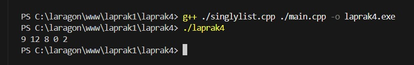
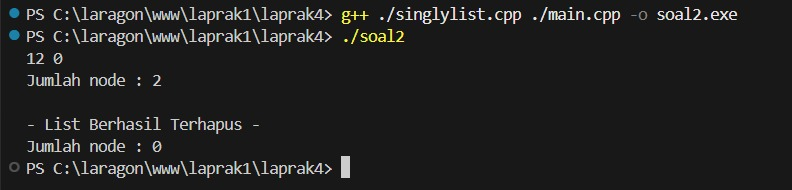

# <h1 align="center"> Modul 4 SINGLY LINKED LIST (BAGIAN PERTAMA) </h1>
<p align="center">Muh. Dzaky Luthfi - 109082530015</p>

## Dasar Teori

### A. Pengertian Linked List

Linked List (senarai berantai) adalah struktur data berupa rangkaian elemen data yang saling berkait (berhubungan) dan bersifat fleksibel karena dapat tumbuh dan mengecil sesuai kebutuhan. Berbeda dengan array yang bersifat statis, linked list menggunakan pointer yang bersifat dinamis, sehingga lebih cocok untuk data yang jumlahnya tidak diketahui di awal.

## B. Singly Linked List

Singly Linked List adalah model ADT Linked List yang hanya memiliki satu arah pointer. Setiap elemen terdiri dari:

Data: Informasi utama yang tersimpan.

Successor (next): Pointer penghubung ke elemen berikutnya.

Sifat:

Hanya memerlukan satu pointer.

Node akhir menunjuk ke Nil.

Pembacaan hanya bisa maju (satu arah).

Lebih mudah melakukan insert/delete di tengah list.

Istilah Penting:

Istilah	Deskripsi
first/head	Pointer ke elemen pertama list.
next	Pointer ke elemen berikutnya.
Nil/NULL	Pointer kosong (tidak mengacu ke mana pun).
Node	Tempat penyimpanan data di memori.

Alokasi dan Dealokasi Memori
Alokasi (C++): P = new elmlist; — Membuat node baru di memori.

Dealokasi (C++): delete P; — Menghapus node dari memori.

4. Operasi Dasar Linked List
CreateList — Membuat list kosong (first = Nil).

Insert — Menambah elemen:

insertFirst → di awal list.

insertLast → di akhir list.

insertAfter → setelah node tertentu.

Delete — Menghapus elemen:

deleteFirst → hapus elemen awal.

deleteLast → hapus elemen akhir.

deleteAfter → hapus elemen setelah node tertentu.

View (printInfo) — Menampilkan isi list dengan penelusuran.

Update — Mengubah data di dalam list (diawali pencarian).## C. Abstract Data Type (ADT)
ADT adalah sebuah TYPE beserta sekumpulan PRIMITIF (operasi dasar) terhadap type tersebut. Implementasi ADT terdiri dari:

Header (.h) — Spesifikasi type dan primitif.

Body (.cpp) — Realisasi/implementasi primitif.

Driver (main.cpp) — Program utama yang memanfaatkan ADT.

## Guided 

### 1. Program list.h

```C++
#ifndef LIST_h
#define LIST_h
#define Nil NULL

#include <iostream>
using namespace std;

struct mahasiswa {
    string nama;
    string nim;
    int umur;
};

typedef mahasiswa datamahasiswa;

typedef struct mode *address;

struct mode {
    datamahasiswa isidata;
    address next;
};

struct linked list {
    address first;
}

bool isEmpty(linkedlist list);
void createList(linkedlist &list);
address alokasi(string nama, string nim, int umur);
void dealokasi(address &node);
void printList(linkedlist list);
void insertFirst(linkedlist &list, address nodeBaru);
void insertAfter(linkedlist &list, address nodeBaru, address Prev);
void insertLast(linkedlist &list, address nodeBaru);

void delFirst(linkedlist &list);
void delLast(linkedlist &list);
void delAfter(linkedlist &list, address nodeHapus, address nodePrev);
int nbList(linkedlist list);
void deleteFirst(linkedlist &list);

#endif
```
File list.h adalah file header yang berfungsi sebagai antarmuka (interface) dari Abstract Data Type (ADT) Linked List. File ini mendeklarasikan struktur data, tipe bentukan, serta prototipe semua fungsi dan prosedur yang akan diimplementasikan di file list.cpp.

### 2. Program list.cpp

```C++
#include "list.h"
#include <iostream>
using namespace std;

// I.S = Initial State / kondisi awal
// F.S = Final State / kondisi akhir

// Fungsi untuk cek apakah list kosong atau tidak
bool isEmpty(LinkedList List) {
    if(List.first == Nil) {
        return true;
    } else {
        return false;
    }
}

// pembuatan linked list kosong
void createList(LinkedList &List) {
    /* I.S. sembarang
       F.S. terbentuk list kosong */
    List.first = Nil;
}

// pembuatan node baru dengan menerapkan manajemen memori
address alokasi(string nama, string nim, int umur) {
    /* I.S. sembarang
       F.S. mengembalikan alamat node baru dengan isidata = sesuai parameter dan next = Nil */
    address nodeBaru = new node;
    nodeBaru->isidata.nama = nama;
    nodeBaru->isidata.nim = nim;
    nodeBaru->isidata.umur = umur;
    nodeBaru->next = Nil;
    return nodeBaru;
}

// penghapusan node dengan menerapkan manajemen memori
void dealokasi(address &node) {
    /* I.S. P terdefinisi
       F.S. memori yang digunakan node dikembalikan ke sistem */
    node->next = Nil;
    delete node;
}

// prosedur-prosedur untuk insert / menambahkan node baru kedalam list
void insertFirst(LinkedList &List, address nodeBaru) {
    /* I.S. sembarang, P sudah dialokasikan
       F.S. menempatkan elemen list (node) pada awal list */
    nodeBaru->next = List.first;
    List.first = nodeBaru;
}

void insertAfter(LinkedList &List, address nodeBaru, address Prev) {
    /* I.S. sembarang, nodeBaru dan Prev alamat salah satu elemen list (node)
       F.S. menempatkan elemen (node) sesudah elemen node Prev */
    if (Prev != Nil) {
        nodeBaru->next = Prev->next;
        Prev->next = nodeBaru;
    } else {
        cout << "Node sebelumnya tidak valid!" << endl;
    }
}

void insertLast(LinkedList &List, address nodeBaru) {
    /* I.S. sembarang, nodeBaru sudah dialokasikan
       F.S. menempatkan elemen nodeBaru pada akhir list */
    if (isEmpty(List)) {
        List.first = nodeBaru;
    } else {
        address nodeBantu = List.first;
        while (nodeBantu->next != Nil) {
            nodeBantu = nodeBantu->next;
        }
        nodeBantu->next = nodeBaru;
    }
}

// prosedur-prosedur untuk delete / menghapus node yang ada didalam list
void delFirst(LinkedList &List) {
    /* I.S. list tidak kosong
       F.S. node pertama di list terhapus */
    address nodeHapus;
    if (isEmpty(List) == false) {
        nodeHapus = List.first;
        List.first = List.first->next;
        nodeHapus->next = Nil;
        dealokasi(nodeHapus);
    } else {
        cout << "List kosong!" << endl;
    }
}

void delLast(LinkedList &List) {
    /* I.S. list tidak kosong
       F.S. node terakhir di list terhapus */
    address nodeHapus, nodePrev;
    if(isEmpty(List) == false) {
        nodeHapus = List.first;
        if(nodeHapus->next == Nil) {
            List.first->next = Nil;
            dealokasi(nodeHapus);
        } else {
            while(nodeHapus->next != Nil) {
                nodePrev = nodeHapus;
                nodeHapus = nodeHapus->next;
            }
            nodePrev->next = Nil;
            dealokasi(nodeHapus);
        }
    } else {
        cout << "List kosong" << endl;
    }
}

void delAfter(LinkedList &List, address nodeHapus, address nodePrev) {
    /* I.S. list tidak kosong, Prev alamat salah satu elemen list
       F.S. nodeBantu adalah alamat dari Prev->next, menghapus Prev->next dari list */
    if(isEmpty(List) == true) {
        cout << "List kosong!" << endl;
    } else { //jika list tidak kosong
        if (nodePrev != Nil && nodePrev->next != Nil) {
            nodeHapus = nodePrev->next;
            nodePrev->next = nodeHapus->next;
            nodeHapus->next = Nil;
            dealokasi(nodeHapus);
        } else {
            cout << "Node sebelumnya (prev) tidak valid!" << endl;
        }
    }
}

// prosedur untuk menampilkan isi list
void printList(LinkedList List) {
    /* I.S. list mungkin kosong
       F.S. jika list tidak kosong menampilkan semua info yang ada pada list */
    if (isEmpty(List)) {
        cout << "List kosong." << endl;
    } else {
        address nodeBantu = List.first;
        while (nodeBantu != Nil) {
            cout << "Nama : " << nodeBantu->isidata.nama << ", NIM : " << nodeBantu->isidata.nim << ", Usia : " << nodeBantu->isidata.umur << endl;
            nodeBantu = nodeBantu->next;
        }
    }
}

// Function untuk menampilkan jumlah node didalam list
int nbList(LinkedList List) {
    /* I.S. list sudah ada
       F.S. menampilkan jumlah node didalam list */
    int count = 0;
    address nodeBantu = List.first;
    while (nodeBantu != Nil) {
        count++;
        nodeBantu = nodeBantu->next;
    }
    return count;
}

// prosedur untuk menghapus list (menghapus semua node didalam list)
void deleteList(LinkedList &List) {
    /* I.S. list sudah ada
       F.S. menghapus semua node didalam list */
    address nodeBantu, nodeHapus;
    nodeBantu = List.first;
    while(nodeBantu != Nil) {
        nodeHapus = nodeBantu;
        nodeBantu = nodeBantu->next;
        dealokasi(nodeHapus);
    }
    List.first = Nil;
    cout << "List sudah terhapus!" << endl;
}
```
File list.cpp adalah bagian implementasi dari Abstract Data Type (ADT) Linked List. File ini berisi definisi semua prosedur dan fungsi yang telah dideklarasikan di file header list.h. Program ini menerapkan manajemen memori dinamis menggunakan operator new dan delete.


### 3. Program Main.cpp

```C++
#include "list.h"
#include <iostream>
using namespace std;

int main(){
    LinkedList List;
    address nodeA, nodeB, nodeC, nodeD, nodeE = Nil;
    createList(List);

    dataMahasiswa mhs;

    nodeA = alokasi("Dhimas", "2311102151", 20);
    nodeB = alokasi("Arvin", "221110014", 21);
    nodeC = alokasi("Rizal", "231110029", 20);
    nodeD = alokasi("Satro", "211102173", 21);
    nodeE = alokasi("Joshua", "2311102133", 21);

    insertFirst(List, nodeA);
    insertLast(List, nodeB);
    insertAfter(List, nodeC, nodeA);
    insertAfter(List, nodeD, nodeC);
    insertLast(List, nodeE);

    cout << "--- ISI LIST SETELAH DILAKUKAN INSERT ---" << endl;
    printList(List);
    cout << "Jumlah node : " << nbList(List) << endl;
    cout << endl;

    delFirst(List);
    delLast(List);
    delAfter(List, nodeD, nodeC);

    cout << "--- ISI LIST SETELAH DILAKUKAN DELETE ---" << endl;
    printList(List);
    cout << "Jumlah node : " << nbList(List) << endl;
    cout << endl;

    deleteList(List);
    cout << "--- ISI LIST SETELAH DILAKUKAN HAPUS LIST ---" << endl;
    printList(List);
    cout << "Jumlah node : " << nbList(List) << endl;
    cout << endl;

    return 0;
}
```
Program ini adalah implementasi struktur data Singly Linked List (Senarai Berantai Tunggal) menggunakan bahasa C++ untuk mengelola data mahasiswa. Program ini menerapkan konsep manajemen memori dinamis (alokasi dan dealokasi) serta Abstract Data Type (ADT) dengan memisahkan file header (list.h), implementasi (list.cpp), dan program utama (main.cpp).


## Unguided 

### 1. Buatlah ADT Singly Linked list sebagai berikut di dalam file “Singlylist.h” 
### Kemudian buatlah implementasi dari procedure-procedure yang digunakan didalam file “Singlylist.cpp” Kemudian buat program utama didalam file “main.cpp” dengan implementasi sebagai berikut : Sehingga linkedlist yang dibuat akan seperti ini : Output yang diharapkan : 9,12,8,0,2 
    

```C++
//singlylist.h
#ifndef SINGLYLIST_H
#define SINGLYLIST_H

#include <iostream>
using namespace std;

// Definisi Type infotype
typedef int infotype;

// Definisi pointer ke ElmList
typedef struct ElmList *address;

// Definisi Struct ElmList
struct ElmList {
    infotype info;
    address next;
};

// Definisi Struct List
struct List {
    address First;
};

// Deklarasi Prosedur dan Fungsi
void CreateList(List &L);
address alokasi(infotype x);
void dealokasi(address &P);
void printInfo(List L);
void insertFirst(List &L, address P);

#endif
```
```C++
//singlylist.cpp
#include "Singlylist.h"

// Prosedur untuk membuat list kosong
void CreateList(List &L) {
    L.First = NULL;
}

// Fungsi untuk mengalokasikan memori untuk elemen baru
address alokasi(infotype x) {
    address P = new ElmList;
    if (P != NULL) {
        P->info = x;
        P->next = NULL;
    }
    return P;
}

// Prosedur untuk menghapus elemen dari memori
void dealokasi(address &P) {
    delete P;
    P = NULL;
}

// Prosedur untuk menampilkan isi list
void printInfo(List L) {
    address P = L.First;
    while (P != NULL) {
        cout << P->info;
        if (P->next != NULL) {
            cout << " ";
        }
        P = P->next;
    }
    cout << endl;
}

// Prosedur untuk menambahkan elemen di awal list
void insertFirst(List &L, address P) {
    if (P != NULL) {
        P->next = L.First;
        L.First = P;
    }
}
```
```C++
//main.cpp
#include "Singlylist.h"

int main() {
    List L;
    address P1, P2, P3, P4, P5 = NULL;

    CreateList(L);

    P1 = alokasi(2);
    insertFirst(L, P1);

    P2 = alokasi(0);
    insertFirst(L, P2);

    P3 = alokasi(8);
    insertFirst(L, P3);

    P4 = alokasi(12);
    insertFirst(L, P4);

    P5 = alokasi(9);
    insertFirst(L, P5);

    printInfo(L);

    return 0;
}
```

### Output Unguided 1 :

##### Output 1


Kode Soal 1 adalah program C++ yang mengimplementasikan Singly Linked List (senarai berantai tunggal) menggunakan tiga file: Singlylist.h (definisi struct dan prototipe fungsi), Singlylist.cpp (implementasi fungsi), dan main.cpp (program utama).

Struktur node (ElmList) terdiri dari info (nilai integer) dan next (pointer ke node berikutnya), sedangkan struct List hanya menyimpan First sebagai penunjuk node awal. Fungsi yang digunakan meliputi CreateList (inisialisasi list kosong), alokasi (memesan memori node baru), insertFirst (menambah node di depan), printInfo (menampilkan isi list), dan dealokasi (membebaskan memori).

Pada program utama, lima angka (2, 0, 8, 12, 9) dimasukkan secara berurutan menggunakan insertFirst, sehingga urutan list menjadi terbalik dari input. Hasil akhirnya adalah 9 → 12 → 8 → 0 → 2, yang ditampilkan ke layar.

### 2. Dari soal Latihan pertama, lakukan penghapusan node 9 menggunakan deleteFirst(), node 2 menggunakan deleteLast(), dan node 8 menggunakan deleteAfter(). Kemudian tampilkan jumlah node yang tersimpan menggunakan nbList() dan lakukan penghapusan seluruh node menggunakan deleteList(). Output yang diharapkan : 

```C++
//singlylist.h
#ifndef SINGLYLIST_H
#define SINGLYLIST_H

#include <iostream>
using namespace std;

// Definisi Type infotype
typedef int infotype;

// Definisi pointer ke ElmList
typedef struct ElmList *address;

// Definisi Struct ElmList
struct ElmList {
    infotype info;
    address next;
};

// Definisi Struct List
struct List {
    address First;
};

// --- Deklarasi Prosedur dan Fungsi ---

// Fungsi Dasar (Soal 1)
void CreateList(List &L);
address alokasi(infotype x);
void dealokasi(address &P);
void printInfo(List L);
void insertFirst(List &L, address P);

// Fungsi Tambahan (Soal 2)
void deleteFirst(List &L, address &P);
void deleteLast(List &L, address &P);
void deleteAfter(address Prec, address &P);
int nbList(List L);
void deleteList(List &L);

#endif
```

```C++
//singlylist.cpp
#include "Singlylist.h"

// --- Implementasi Fungsi Dasar ---

void CreateList(List &L) {
    L.First = NULL;
}

address alokasi(infotype x) {
    address P = new ElmList;
    if (P != NULL) {
        P->info = x;
        P->next = NULL;
    }
    return P;
}

void dealokasi(address &P) {
    delete P;
    P = NULL;
}

void printInfo(List L) {
    address P = L.First;
    while (P != NULL) {
        cout << P->info;
        if (P->next != NULL) {
            cout << " ";
        }
        P = P->next;
    }
    cout << endl;
}

void insertFirst(List &L, address P) {
    if (P != NULL) {
        P->next = L.First;
        L.First = P;
    }
}

// --- Implementasi Fungsi Tambahan (Soal 2) ---

// Menghapus elemen pertama
void deleteFirst(List &L, address &P) {
    if (L.First != NULL) {
        P = L.First;
        L.First = L.First->next;
        P->next = NULL;
    } else {
        P = NULL;
    }
}

// Menghapus elemen terakhir
void deleteLast(List &L, address &P) {
    if (L.First == NULL) {
        P = NULL;
    } else if (L.First->next == NULL) {
        P = L.First;
        L.First = NULL;
    } else {
        address Q = L.First;
        while (Q->next->next != NULL) {
            Q = Q->next;
        }
        P = Q->next;
        Q->next = NULL;
    }
}

// Menghapus elemen setelah node Prec
void deleteAfter(address Prec, address &P) {
    if (Prec != NULL && Prec->next != NULL) {
        P = Prec->next;
        Prec->next = P->next;
        P->next = NULL;
    } else {
        P = NULL;
    }
}

// Menghitung jumlah elemen (node)
int nbList(List L) {
    int count = 0;
    address P = L.First;
    while (P != NULL) {
        count++;
        P = P->next;
    }
    return count;
}

// Menghapus seluruh elemen di dalam list
void deleteList(List &L) {
    address P;
    while (L.First != NULL) {
        deleteFirst(L, P);
        dealokasi(P);
    }
}
```
```C++
//main.cpp
#include "Singlylist.h"

int main() {
    List L;
    address P1, P2, P3, P4, P5, P;
    address Prec;

    // 1. Inisialisasi List Kosong
    CreateList(L);

    // 2. Membuat List Awal: 9 -> 12 -> 8 -> 0 -> 2
    // (Menggunakan insertFirst, maka input dibalik urutannya)
    P1 = alokasi(2);
    insertFirst(L, P1);
    P2 = alokasi(0);
    insertFirst(L, P2);
    P3 = alokasi(8);
    insertFirst(L, P3);
    P4 = alokasi(12);
    insertFirst(L, P4);
    P5 = alokasi(9);
    insertFirst(L, P5);

    // --- PROSES SOAL 2 ---

    // a. Hapus node 9 (di awal) menggunakan deleteFirst()
    deleteFirst(L, P);
    dealokasi(P); // Hapus dari memori
    // List saat ini: 12 -> 8 -> 0 -> 2

    // b. Hapus node 2 (di akhir) menggunakan deleteLast()
    deleteLast(L, P);
    dealokasi(P); // Hapus dari memori
    // List saat ini: 12 -> 8 -> 0

    // c. Hapus node 8 menggunakan deleteAfter()
    // Node 8 berada setelah node 12. Kita perlu mencari posisi node 12.
    Prec = L.First; // Prec menunjuk ke node 12
    if (Prec != NULL && Prec->next != NULL) {
        deleteAfter(Prec, P); // Hapus node setelah 12 (yaitu 8)
        dealokasi(P); // Hapus dari memori
    }
    // List saat ini: 12 -> 0

    // d. Tampilkan list dan jumlah node
    printInfo(L);
    cout << "Jumlah node : " << nbList(L) << endl;

    // e. Hapus seluruh node menggunakan deleteList()
    deleteList(L);
    
    // Tampilkan output akhir
    cout << endl;
    cout << "- List Berhasil Terhapus -" << endl;
    cout << "Jumlah node : " << nbList(L) << endl;

    return 0;
}
```
### Output Unguided 2 :

##### Output 2


Program ini adalah implementasi ADT (Abstract Data Type) Pelajaran dalam C++ yang dipisah menjadi 3 file modular: pelajaran.h (header), pelajaran.cpp (implementasi), dan main.cpp (program utama).

Pada file pelajaran.h, terdapat header guard (#ifndef, #define, #endif) untuk mencegah duplikasi deklarasi, include <iostream> dan using namespace std;, serta deklarasi struct pelajaran dengan dua field yaitu namaMapel dan kodeMapel. Selain itu, dideklarasikan dua prototipe fungsi: create_pelajaran() yang mengembalikan objek pelajaran, dan tampil_pelajaran() yang bertipe void.

Pada file pelajaran.cpp, diimplementasikan fungsi create_pelajaran() yang menerima parameter namapel dan kodepel, mengisinya ke dalam struct pelajaran, lalu mengembalikan objek tersebut. Selanjutnya, prosedur tampil_pelajaran() menampilkan isi field namaMapel dan kodeMapel menggunakan cout.

Pada file main.cpp, program utama menyiapkan variabel namapel = "Struktur Data" dan kodepel = "STD", lalu memanggil create_pelajaran() untuk membuat objek pel, dan menampilkannya dengan tampil_pelajaran(pel). Output yang dihasilkan adalah nama pelajaran "Struktur Data" dan kode "STD".

Program ini menerapkan konsep ADT, modular programming, header guard, function return value, procedure void, dan pass by value. Kompilasinya harus menyertakan kedua file .cpp, misalnya g++ main.cpp pelajaran.cpp -o soal2.exe, karena deklarasi dan implementasi dipisah. Pendekatan ini membuat kode lebih rapi, reusable, dan menjadi dasar sebelum mempelajari OOP di C++.


## Kesimpulan
Modul 4 ini membahas konsep Singly Linked List sebagai salah satu implementasi dari Abstract Data Type (ADT) yang bersifat dinamis, di mana elemen-elemen data (node) saling terhubung melalui pointer. Berbeda dengan array yang bersifat statis dan memiliki ukuran tetap, linked list dapat tumbuh dan mengecil sesuai kebutuhan, sehingga lebih fleksibel untuk menangani data yang jumlahnya tidak diketahui di awal. Setiap node pada singly linked list terdiri dari dua bagian utama, yaitu info (data yang disimpan) dan next (pointer ke node berikutnya), dengan node terakhir menunjuk ke NULL sebagai penanda akhir list.

Implementasi ADT Singly Linked List dalam C++ dilakukan secara modular dengan memisahkan kode menjadi tiga file: header (.h) yang berisi definisi tipe data dan prototipe fungsi, implementasi (.cpp) yang berisi realisasi dari setiap primitif, serta driver (main.cpp) sebagai program utama yang memanfaatkan ADT tersebut. Pemisahan ini membuat kode lebih rapi, terstruktur, dan mudah dipelihara.

Pada bagian Guided, dipraktikkan pembuatan ADT Linked List untuk mengelola data mahasiswa (nama, NIM, umur) dengan berbagai operasi dasar, meliputi:

CreateList — membuat list kosong.

Alokasi & Dealokasi — manajemen memori dinamis menggunakan new dan delete.

Insert — insertFirst, insertAfter, dan insertLast untuk menambahkan node.

Delete — delFirst, delLast, dan delAfter untuk menghapus node.

View — printList untuk menampilkan isi list.

nbList — menghitung jumlah node.

deleteList — menghapus seluruh node dalam list.

Pada bagian Unguided, diterapkan dua latihan yang memperkuat pemahaman konsep linked list:

Latihan pertama membuat ADT Singly Linked List sederhana dengan tipe data infotype bertipe integer, yang melibatkan fungsi CreateList, alokasi, dealokasi, insertFirst, dan printInfo. Lima angka (2, 0, 8, 12, 9) dimasukkan menggunakan insertFirst, sehingga urutan list menjadi terbalik dari input, yaitu 9 → 12 → 8 → 0 → 2.

Latihan kedua melanjutkan latihan pertama dengan menambahkan operasi penghapusan, yaitu deleteFirst (menghapus node 9), deleteLast (menghapus node 2), dan deleteAfter (menghapus node 8), serta fungsi nbList untuk menghitung jumlah node dan deleteList untuk menghapus seluruh node. Hasil akhirnya, list berisi 12 → 0 dengan jumlah node 2, kemudian seluruh node dihapus sehingga list menjadi kosong.

Secara keseluruhan, modul ini menegaskan bahwa Singly Linked List merupakan struktur data dinamis yang sangat berguna untuk operasi penambahan dan penghapusan data, terutama di awal list yang hanya membutuhkan waktu O(1). Konsep pointer, manajemen memori dinamis, pass by reference, dan modular programming yang telah dipelajari sebelumnya menjadi dasar penting dalam mengimplementasikan ADT ini. Penguasaan materi pada modul ini menjadi pondasi krusial sebelum melangkah ke struktur data yang lebih kompleks seperti Double Linked List, Circular Linked List, serta pemrograman berorientasi objek (OOP) yang lebih lanjut.

## Referensi
[1] Malik, D. S. (2010). Data Structures Using C++ (2nd ed.). Boston: Cengage Learning. 

[2] Drozdek, A. (2013). Data Structures and Algorithms in C++ (4th ed.). Boston: Cengage Learning. 
<br>...
