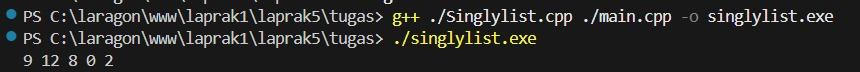

# <h1 align="center"> Modul 5 SINGLY LINKED LIST (BAGIAN KEDUA) </h1>
<p align="center">Muh. Dzaky Luthfi - 109082530015</p>

## Dasar Teori

### A. Singly Linked List

Singly linked list adalah struktur data berupa rangkaian node yang saling terhubung melalui pointer. Setiap node menyimpan data (`info`) dan alamat node berikutnya (`next`). Hubungan antar node hanya satu arah, dan node terakhir menunjuk ke `Nil` (`NULL`) sebagai penanda akhir list. List dianggap kosong jika `L.first = Nil`.

### B. Abstract Data Type (ADT)

Semua operasi dasar list merupakan bagian dari ADT singly linked list. Pada C/C++, ADT disimpan dalam dua file, yaitu header (`*.h`) yang berisi deklarasi tipe dan prototype primitif, serta file implementasi (`*.cpp`) yang berisi realisasi primitifnya. Program utama (`main.cpp`) berperan sebagai driver yang memanfaatkan ADT tersebut.

### C. Operasi Dasar

Operasi dasar pada list meliputi pembuatan list kosong (`CreateList`), alokasi dan dealokasi memori node (`alokasi`, `dealokasi`), penambahan elemen (`insertFirst`, `insertLast`, `insertAfter`), penghapusan elemen (`delFirst`, `delLast`, `delAfter`), serta penampilan isi list (`printInfo`).

### D. Searching

Searching adalah operasi pencarian node tertentu dengan mengunjungi setiap node dari awal list dan berhenti setelah node yang dicari ditemukan. Fungsi `findElm` mengembalikan alamat node yang berisi nilai yang dicari, atau `Nil` jika tidak ditemukan. Operasi ini mempermudah operasi lain seperti insert after, delete after, dan update.
## Guided 

### 1. Program listBuah.h

```C++
#ifndef LISTBUAH_H
#define LISTBUAH_H

#define Nil nullptr

#include <iostream>
#include <string>
using namespace std;

struct buah {
    string nama;
    int    jumlah;
    float  harga;
};

typedef buah dataBuah;

typedef struct node *address;

struct node {
    dataBuah isidata;
    address  next;
};

struct linkedlist {
    address first;
};

bool    isEmpty(linkedlist List);
void    createList(linkedlist &List);
address alokasi(string nama, int jumlah, float harga);
void    dealokasi(address &node);
void    printList(linkedlist List);
void    insertFirst(linkedlist &List, address nodeBaru);
void    insertAfter(linkedlist &List, address nodeBaru, address prev);
void    insertLast(linkedlist &List, address nodeBaru);
void    delFirst(linkedlist &List);
void    delLast(linkedlist &List);
void    delAfter(linkedlist &List, address nodePrev);
int     nbList(linkedlist List);
void    deleteList(linkedlist &List);

void    updateFirst(linkedlist &List);
void    updateLast(linkedlist &List);
void    updateAfter(linkedlist &List, address nodePrev);

void    FindNodeByData(linkedlist list, string data);
void    FindNodeByAddress(linkedlist list, address node);
void    FindNodeByRange(linkedlist list, float hargaAwal, float hargaAkhir);

#endif
```
File ini adalah header (`listBuah.h`) yang berisi deklarasi tipe data dan prototype fungsi untuk ADT singly linked list data buah. `Nil` didefinisikan sebagai `nullptr`, struct `buah` menyimpan nama, jumlah, dan harga, lalu struct `node` berisi `isidata` dan pointer `next` yang bertipe `address`. Struct `linkedlist` hanya memiliki satu field, yaitu `first`, yang menunjuk ke node pertama. Setelah itu dideklarasikan prototype semua fungsi yang diimplementasikan di `listBuah.cpp`, yaitu pembuatan dan alokasi, insert, delete, update, searching, serta `printList` dan `nbList`. Seluruh isinya dibungkus `#ifndef LISTBUAH_H` agar tidak terdeklarasi ganda saat di-include.
### 2. Program listBuah.cpp

```C++
#include "listBuah.h"
#include <iostream>
using namespace std;

// cek apakah list kosong
bool isEmpty(linkedlist List) {
    return List.first == Nil;
}

// buat linked list kosong
void createList(linkedlist &List) {
    List.first = Nil;
}

// alokasi node baru
address alokasi(string nama, int jumlah, float harga) {
    address nodeBaru = new node;
    nodeBaru->isidata.nama   = nama;
    nodeBaru->isidata.jumlah = jumlah;
    nodeBaru->isidata.harga  = harga;
    nodeBaru->next           = Nil;
    return nodeBaru;
}

// dealokasi node
void dealokasi(address &node) {
    delete node;
    node = Nil;
}

// insert
void insertFirst(linkedlist &List, address nodeBaru) {
    nodeBaru->next = List.first;
    List.first     = nodeBaru;
}

void insertAfter(linkedlist &List, address nodeBaru, address prev) {
    (void)List; // tidak dipakai, tapi jaga signature
    if (prev != Nil) {
        nodeBaru->next = prev->next;
        prev->next     = nodeBaru;
    } else {
        cout << "Node sebelumnya tidak valid!" << endl;
    }
}

void insertLast(linkedlist &List, address nodeBaru) {
    if (isEmpty(List)) {
        List.first = nodeBaru;
    } else {
        address nodeBantu = List.first;
        while (nodeBantu->next != Nil) {
            nodeBantu = nodeBantu->next;
        }
        nodeBantu->next = nodeBaru;
    }
}

// delete
void delFirst(linkedlist &List) {
    if (!isEmpty(List)) {
        address nodeHapus = List.first;
        List.first = List.first->next;
        dealokasi(nodeHapus);
        cout << "Node pertama berhasil terhapus!" << endl;
    } else {
        cout << "List kosong!" << endl;
    }
}

void delLast(linkedlist &List) {
    if (!isEmpty(List)) {
        address nodeHapus = List.first;
        if (nodeHapus->next == Nil) {         // hanya satu node
            List.first = Nil;
            dealokasi(nodeHapus);
        } else {
            address nodePrev = Nil;
            while (nodeHapus->next != Nil) {
                nodePrev  = nodeHapus;
                nodeHapus = nodeHapus->next;
            }
            nodePrev->next = Nil;
            dealokasi(nodeHapus);
        }
        cout << "Node terakhir berhasil terhapus!" << endl;
    } else {
        cout << "List kosong!" << endl;
    }
}

void delAfter(linkedlist &List, address nodePrev) {
    if (isEmpty(List)) {
        cout << "List kosong!" << endl;
    } else if (nodePrev != Nil && nodePrev->next != Nil) {
        address nodeHapus = nodePrev->next;
        nodePrev->next    = nodeHapus->next;
        dealokasi(nodeHapus);
        cout << "Node setelah node " << nodePrev->isidata.nama
             << " berhasil terhapus!" << endl;
    } else {
        cout << "Node sebelumnya (prev) tidak valid!" << endl;
    }
}

// tampilkan list
void printList(linkedlist List) {
    if (isEmpty(List)) {
        cout << "List kosong." << endl;
    } else {
        address nodeBantu = List.first;
        while (nodeBantu != Nil) {
            cout << "Nama Buah : " << nodeBantu->isidata.nama
                 << ", Jumlah : " << nodeBantu->isidata.jumlah
                 << ", Harga : "  << nodeBantu->isidata.harga << endl;
            nodeBantu = nodeBantu->next;
        }
    }
}

// jumlah node
int nbList(linkedlist List) {
    int count = 0;
    address nodeBantu = List.first;
    while (nodeBantu != Nil) {
        count++;
        nodeBantu = nodeBantu->next;
    }
    return count;
}

// hapus seluruh list
void deleteList(linkedlist &List) {
    address nodeBantu = List.first;
    while (nodeBantu != Nil) {
        address nodeHapus = nodeBantu;
        nodeBantu = nodeBantu->next;
        dealokasi(nodeHapus);
    }
    List.first = Nil;
    cout << "List berhasil terhapus!" << endl;
}

// update
void updateFirst(linkedlist &List) {
    if (isEmpty(List)) {
        cout << "List kosong!" << endl;
    } else {
        cout << "Masukkan update data node pertama :" << endl;
        cout << "Nama buah : "; cin >> List.first->isidata.nama;
        cout << "Jumlah    : "; cin >> List.first->isidata.jumlah;
        cout << "Harga     : "; cin >> List.first->isidata.harga;
        cout << "Data Berhasil Diupdate!" << endl << endl;
    }
}

void updateLast(linkedlist &List) {
    if (isEmpty(List)) {
        cout << "List kosong!" << endl;
    } else {
        address nodeBantu = List.first;
        while (nodeBantu->next != Nil) {
            nodeBantu = nodeBantu->next;
        }
        cout << "Masukkan update data node terakhir :" << endl;
        cout << "Nama buah : "; cin >> nodeBantu->isidata.nama;
        cout << "Jumlah    : "; cin >> nodeBantu->isidata.jumlah;
        cout << "Harga     : "; cin >> nodeBantu->isidata.harga;
        cout << "Data Berhasil Diupdate!" << endl << endl;
    }
}

void updateAfter(linkedlist &List, address nodePrev) {
    if (isEmpty(List)) {
        cout << "List kosong!" << endl;
    } else if (nodePrev != Nil && nodePrev->next != Nil) {
        address nodeBantu = nodePrev->next;
        cout << "Masukkan update data node setelah node "
             << nodePrev->isidata.nama << " :" << endl;
        cout << "Nama buah : "; cin >> nodeBantu->isidata.nama;
        cout << "Jumlah    : "; cin >> nodeBantu->isidata.jumlah;
        cout << "Harga     : "; cin >> nodeBantu->isidata.harga;
        cout << "Data Berhasil Diupdate!" << endl << endl;
    } else {
        cout << "Node sebelumnya (prev) tidak valid!" << endl;
    }
}

// searching
void FindNodeByData(linkedlist list, string data) {
    if (isEmpty(list)) {
        cout << "List kosong!" << endl;
    } else {
        address nodeBantu = list.first;
        int posisi = 0;
        bool found = false;
        while (nodeBantu != Nil) {
            posisi++;
            if (nodeBantu->isidata.nama == data) {
                cout << "Data " << data << " ditemukan pada posisi ke-"
                     << posisi << "!" << endl;
                cout << "Nama Buah : " << nodeBantu->isidata.nama
                     << ", Jumlah : " << nodeBantu->isidata.jumlah
                     << ", Harga : "  << nodeBantu->isidata.harga << endl;
                found = true;
                break;
            }
            nodeBantu = nodeBantu->next;
        }
        if (!found) {
            cout << "Node dengan data " << data << " tidak ditemukan!" << endl;
        }
    }
    cout << endl;
}

void FindNodeByAddress(linkedlist list, address node) {
    if (isEmpty(list)) {
        cout << "List kosong!" << endl;
    } else {
        address nodeBantu = list.first;
        int posisi = 0;
        bool found = false;
        while (nodeBantu != Nil) {
            posisi++;
            if (nodeBantu == node) {
                cout << "Node ditemukan pada posisi ke-" << posisi << "!" << endl;
                cout << "Alamat node : " << nodeBantu << endl;
                cout << "Nama Buah : " << nodeBantu->isidata.nama
                     << ", Jumlah : " << nodeBantu->isidata.jumlah
                     << ", Harga : "  << nodeBantu->isidata.harga << endl;
                found = true;
                break;
            }
            nodeBantu = nodeBantu->next;
        }
        if (!found) {
            cout << "Node dengan alamat " << node
                 << " tidak ditemukan dalam list!" << endl;
        }
    }
    cout << endl;
}

void FindNodeByRange(linkedlist list, float hargaAwal, float hargaAkhir) {
    if (isEmpty(list)) {
        cout << "List kosong!" << endl;
    } else {
        address nodeBantu = list.first;
        int posisi = 0;
        bool found = false;
        cout << "--- Buah dalam range harga " << hargaAwal
             << " - " << hargaAkhir << " ---" << endl;
        cout << "-------------------------------------------" << endl;
        while (nodeBantu != Nil) {
            posisi++;
            float harga = nodeBantu->isidata.harga;
            if (harga >= hargaAwal && harga <= hargaAkhir) {
                cout << "Data ditemukan pada posisi ke-" << posisi << " :" << endl;
                cout << "Nama Buah : " << nodeBantu->isidata.nama
                     << ", Jumlah : " << nodeBantu->isidata.jumlah
                     << ", Harga : "  << nodeBantu->isidata.harga << endl;
                cout << "-------------------------------------------" << endl;
                found = true;
            }
            nodeBantu = nodeBantu->next;
        }
        if (!found) {
            cout << "Tidak ada data buah dalam range harga tersebut!" << endl;
            cout << "-------------------------------------------" << endl;
        }
    }
    cout << endl;
}
```
File ini adalah implementasi (`listBuah.cpp`) dari ADT singly linked list data buah, dengan tiap node berisi nama, jumlah, harga, dan pointer `next`. Fungsinya mencakup pembuatan list dan node (`createList`, `alokasi`, `dealokasi`), penambahan node (`insertFirst`, `insertAfter`, `insertLast`), penghapusan node (`delFirst`, `delLast`, `delAfter`, `deleteList`), serta penampilan dan penghitungan node (`printList`, `nbList`). Fungsi update mengubah data node melalui input keyboard, dan fungsi searching mencari node berdasarkan nama, alamat, atau rentang harga. Setiap fungsi mengecek kondisi list atau pointer terlebih dahulu dan menampilkan pesan jika tidak valid.


### 3. Program Main.cpp

```C++
#include "listBuah.h"
#include <iostream>
using namespace std;

int main() {
    linkedlist List;
    createList(List);

    address nodeA = Nil, nodeB = Nil, nodeC = Nil, nodeD = Nil, nodeE = Nil;

    nodeA = alokasi("Jeruk",    100,  3000);
    nodeB = alokasi("Apel",      75,  4000);
    nodeC = alokasi("Pir",       87,  5000);
    nodeD = alokasi("Semangka",  43, 11500);
    nodeE = alokasi("Durian",    15, 31450);

    insertFirst(List, nodeA);
    insertLast (List, nodeB);
    insertAfter(List, nodeC, nodeA);
    insertAfter(List, nodeD, nodeC);
    insertLast (List, nodeE);

    cout << "--- ISI LIST SETELAH DILAKUKAN INSERT ---" << endl;
    printList(List);
    cout << "jumlah node : " << nbList(List) << endl << endl;

    updateFirst(List);
    updateLast (List);
    updateAfter(List, nodeD);

    cout << "--- ISI LIST SETELAH DILAKUKAN UPDATE ---" << endl;
    printList(List);
    cout << "jumlah node : " << nbList(List) << endl << endl;

    FindNodeByData   (List, "Pir");
    FindNodeByAddress(List, nodeC);
    FindNodeByRange  (List, 5000, 10000);

    delFirst(List);
    delLast (List);
    delAfter(List, nodeC);

    cout << "--- ISI LIST SETELAH DILAKUKAN DELETE ---" << endl;
    printList(List);
    cout << "jumlah node : " << nbList(List) << endl << endl;

    deleteList(List);

    cout << "--- ISI LIST SETELAH DILAKUKAN HAPUS LIST ---" << endl;
    printList(List);
    cout << "jumlah node : " << nbList(List) << endl << endl;

    return 0;
}
```
Program ini adalah driver untuk menguji ADT singly linked list data buah (nama, jumlah, harga). List dibuat kosong, lalu lima node dialokasikan dan dimasukkan dengan insertFirst, insertLast, dan insertAfter, sehingga urutannya Jeruk, Pir, Semangka, Apel, Durian (5 node). Berikutnya data node pertama, terakhir, dan node tertentu diubah dengan fungsi update, lalu dicari dengan FindNodeByData, FindNodeByAddress, dan FindNodeByRange (harga 5000 sampai 10000). Setelah itu node pertama, terakhir, dan node setelah Pir dihapus sehingga tersisa 2 node, dan terakhir deleteList mengosongkan seluruh list. Setiap tahap ditampilkan dengan printList dan nbList.

## Unguided 

### 1. Buatlah program C++ yang mengimplementasikan ADT Singly Linked List ke dalam tiga file:

Singlylist.h: Definisikan tipe infotype (int), address (pointer ke ElmList), struct ElmList (berisi info dan next), struct List (berisi First), serta deklarasikan prosedur/fungsi createList, alokasi, dealokasi, printInfo, dan insertFirst.

Singlylist.cpp: Implementasikan seluruh prosedur dan fungsi yang dideklarasikan di file header.

main.cpp: Buat program utama yang mendeklarasikan List L dan pointer P1–P5. Panggil createList(L), lalu masukkan angka 2, 0, 8, 12, 9 secara berurutan menggunakan alokasi dan insertFirst. Terakhir, panggil printInfo(L).
    

```C++
//singlylist.h
#ifndef SINGLYLIST_H
#define SINGLYLIST_H

#include <iostream>
using namespace std;

// Definisi Tipe
typedef int infotype;
typedef struct ElmList *address;

struct ElmList {
    infotype info;
    address next;
};

struct List {
    address First;
};

// Definisi Nilai NULL
const address Nil = NULL;

// Deklarasi Prosedur dan Fungsi
void createList(List &L);
address alokasi(infotype x);
void dealokasi(address &P);
void printInfo(List L);
void insertFirst(List &L, address P);

#endif
```
```C++
//singlylist.cpp
#include "Singlylist.h"
#include <iostream>

using namespace std;

// Membuat list kosong
void createList(List &L) {
    L.First = Nil;
}

// Alokasi memori untuk elemen baru
address alokasi(infotype x) {
    address P = new ElmList;
    if (P != Nil) {
        P->info = x;
        P->next = Nil;
    }
    return P;
}

// Menghapus elemen dari memori
void dealokasi(address &P) {
    delete P;
    P = Nil;
}

// Menampilkan isi list
void printInfo(List L) {
    address P = L.First;
    while (P != Nil) {
        cout << P->info;
        if (P->next != Nil) {
            cout << " ";
        }
        P = P->next;
    }
    cout << endl;
}

// Menambahkan elemen di awal list
void insertFirst(List &L, address P) {
    P->next = L.First;
    L.First = P;
}
```
```C++
//main.cpp
#include <iostream>
#include "Singlylist.h"

using namespace std;

int main() {
    List L;
    address P1, P2, P3, P4, P5 = Nil;
    
    createList(L);

    // Urutan input sesuai gambar soal
    P1 = alokasi(2);
    insertFirst(L, P1);

    P2 = alokasi(0);
    insertFirst(L, P2);

    P3 = alokasi(8);
    insertFirst(L, P3);

    P4 = alokasi(12);
    insertFirst(L, P4);

    P5 = alokasi(9);
    insertFirst(L, P5);

    // Menampilkan hasil
    printInfo(L);

    return 0;
}
```

### Output Unguided 1 :

##### Output 1


Program C++ ini mengimplementasikan Singly Linked List dalam tiga file: Singlylist.h, Singlylist.cpp, dan main.cpp.

File Singlylist.h mendefinisikan infotype (int), address (pointer ke ElmList), struct ElmList (berisi info dan next), struct List (berisi First), konstanta Nil, serta prototipe fungsi createList, alokasi, dealokasi, printInfo, dan insertFirst.

File Singlylist.cpp mengimplementasikan fungsi-fungsi tersebut: createList menginisialisasi list kosong, alokasi memesan memori node baru, dealokasi membebaskan memori, printInfo menampilkan isi list, dan insertFirst menambahkan node di depan list.

File main.cpp menguji ADT dengan mendeklarasikan List L dan pointer P1–P5. Setelah createList, lima angka (2, 0, 8, 12, 9) dimasukkan berurutan menggunakan alokasi dan insertFirst. Karena penambahan selalu di depan, urutan list menjadi terbalik: 9 → 12 → 8 → 0 → 2. Fungsi printInfo menampilkan hasilnya ke layar sebagai 9 12 8 0 2, sesuai Gambar 5-2. Program mengembalikan 0 sebagai tanda sukses.


### 2. Carilah elemen dengan info 8 dengan membuat fungsi baru.
fungsi findElm( L : List, x : infotype ) : address

```C++
//singlylist.h
#ifndef SINGLYLIST_H
#define SINGLYLIST_H

#include <iostream>
using namespace std;

// Definisi Tipe
typedef int infotype;
typedef struct ElmList *address;

struct ElmList {
    infotype info;
    address next;
};

struct List {
    address First;
};

const address Nil = NULL;

// Deklarasi Prosedur dan Fungsi
void createList(List &L);
address alokasi(infotype x);
void dealokasi(address &P);
void printInfo(List L);
void insertFirst(List &L, address P);

// Fungsi Baru untuk Pencarian
address findElm(List L, infotype x);

#endif
```

```C++
//singlylist.cpp
#include "Singlylist.h"

void createList(List &L) {
    L.First = Nil;
}

address alokasi(infotype x) {
    address P = new ElmList;
    if (P != Nil) {
        P->info = x;
        P->next = Nil;
    }
    return P;
}

void dealokasi(address &P) {
    delete P;
    P = Nil;
}

void printInfo(List L) {
    address P = L.First;
    while (P != Nil) {
        cout << P->info;
        if (P->next != Nil) {
            cout << ",";
        }
        P = P->next;
    }
    cout << endl;
}

void insertFirst(List &L, address P) {
    P->next = L.First;
    L.First = P;
}

// Implementasi Fungsi Baru: Pencarian Elemen
address findElm(List L, infotype x) {
    address P = L.First;
    while (P != Nil) {
        if (P->info == x) {
            return P; // Elemen ditemukan, kembalikan alamatnya
        }
        P = P->next;
    }
    return Nil; // Elemen tidak ditemukan
}
```
```C++
//main.cpp
#include "Singlylist.h"

int main() {
    List L;
    address P1, P2, P3, P4, P5 = Nil;
    address found; // Variabel untuk menampung hasil pencarian
    
    createList(L);

    P1 = alokasi(2);
    insertFirst(L, P1);

    P2 = alokasi(0);
    insertFirst(L, P2);

    P3 = alokasi(8);
    insertFirst(L, P3);

    P4 = alokasi(12);
    insertFirst(L, P4);

    P5 = alokasi(9);
    insertFirst(L, P5);

    // Memanggil fungsi pencarian untuk info 8
    found = findElm(L, 8);
    
    // Mengecek apakah elemen ditemukan (tidak sama dengan Nil)
    if (found != Nil) {
        cout << found->info << " ditemukan dalam list" << endl;
    } else {
        cout << "Elemen tidak ditemukan" << endl;
    }
    
    return 0;
}
```
### Output Unguided 2 :

##### Output 2


Pada tahap ini, program C++ yang mengimplementasikan Singly Linked List telah dimodifikasi dengan menambahkan sebuah fungsi baru bernama findElm untuk melakukan pencarian elemen. Fungsi ini dideklarasikan di file Singlylist.h dengan parameter input berupa list (L) dan nilai yang dicari (x), serta mengembalikan tipe data address. Implementasinya di dalam file Singlylist.cpp dilakukan dengan menelusuri list dari node First menggunakan perulangan. Jika nilai info pada suatu node cocok dengan nilai x yang dicari, fungsi akan langsung mengembalikan alamat node tersebut. Jika penelusuran mencapai akhir list (Nil) tanpa menemukan kecocokan, fungsi akan mengembalikan Nil.

Di dalam file main.cpp, setelah list diisi dengan data 9, 12, 8, 0, dan 2, program memanggil fungsi findElm(L, 8) dan menyimpan hasilnya di variabel found. Program kemudian mengecek apakah found tidak sama dengan Nil. Karena angka 8 memang ada di dalam list, program akan mencetak output berupa "8 ditemukan dalam list" ke layar, sesuai dengan hasil yang diharapkan pada Gambar 5-3.

### 3. Hitunglah jumlah total info seluruh elemen (9+12+8+0+2=31).

```C++
//singlylist.h
#ifndef SINGLYLIST_H
#define SINGLYLIST_H

#include <iostream>
using namespace std;

typedef int infotype;
typedef struct ElmList *address;

struct ElmList {
    infotype info;
    address next;
};

struct List {
    address First;
};

const address Nil = NULL;

void createList(List &L);
address alokasi(infotype x);
void dealokasi(address &P);
void printInfo(List L);
void insertFirst(List &L, address P);
address findElm(List L, infotype x);
infotype sumInfo(List L);

#endif
```

```C++
//singlylist.cpp
#include "Singlylist.h"

void createList(List &L) {
    L.First = Nil;
}

address alokasi(infotype x) {
    address P = new ElmList;
    if (P != Nil) {
        P->info = x;
        P->next = Nil;
    }
    return P;
}

void dealokasi(address &P) {
    delete P;
    P = Nil;
}

void printInfo(List L) {
    address P = L.First;
    while (P != Nil) {
        cout << P->info;
        if (P->next != Nil) {
            cout << ",";
        }
        P = P->next;
    }
    cout << endl;
}

void insertFirst(List &L, address P) {
    P->next = L.First;
    L.First = P;
}

address findElm(List L, infotype x) {
    address P = L.First;
    while (P != Nil) {
        if (P->info == x) {
            return P;
        }
        P = P->next;
    }
    return Nil;
}

infotype sumInfo(List L) {
    infotype total = 0;
    address P = L.First;
    while (P != Nil) {
        total = total + P->info;
        P = P->next;
    }
    return total;
}
```
```C++
//main.cpp
#include "Singlylist.h"

int main() {
    List L;
    address P1, P2, P3, P4, P5 = Nil;
    address found;
    infotype total;
    
    createList(L);

    P1 = alokasi(2);   insertFirst(L, P1);
    P2 = alokasi(0);   insertFirst(L, P2);
    P3 = alokasi(8);   insertFirst(L, P3);
    P4 = alokasi(12);  insertFirst(L, P4);
    P5 = alokasi(9);   insertFirst(L, P5);

    found = findElm(L, 8);
    if (found != Nil) {
        cout << found->info << " ditemukan dalam list" << endl;
    } else {
        cout << "Elemen tidak ditemukan" << endl;
    }
    
    total = sumInfo(L);
    cout << "Total info dari kelima elemen adalah " << total << endl;
    
    return 0;
}
```
### Output Unguided 3 :

##### Output 3


Pada tahap ketiga ini, program C++ yang mengimplementasikan Singly Linked List kembali dimodifikasi dengan menambahkan sebuah fungsi baru bernama sumInfo untuk menghitung jumlah total dari seluruh nilai (info) yang ada di dalam list. Fungsi ini dideklarasikan di file Singlylist.h dengan parameter input berupa list (L) dan mengembalikan nilai bertipe infotype (integer).

Implementasi fungsi sumInfo di dalam file Singlylist.cpp dilakukan dengan mendeklarasikan variabel penampung total yang diinisialisasi dengan nilai 0. Program kemudian melakukan penelusuran (traversal) mulai dari node First hingga mencapai Nil menggunakan perulangan. Di dalam perulangan tersebut, nilai info dari setiap node dijumlahkan ke dalam variabel total. Setelah penelusuran selesai, fungsi akan mengembalikan nilai total tersebut.

Di dalam file main.cpp, setelah list diisi dengan data dan proses pencarian angka 8 dilakukan, program memanggil fungsi sumInfo(L) dan menyimpan hasilnya di variabel total. Karena elemen dalam list adalah 9, 12, 8, 0, dan 2, maka hasil penjumlahannya adalah 31. Program kemudian mencetak output ke layar berupa "Total info dari kelima elemen adalah 31", yang persis sesuai dengan hasil yang diharapkan pada Gambar 5-4.


## Kesimpulan

Modul 5 ini membahas lanjutan singly linked list sebagai implementasi Abstract Data Type (ADT) yang bersifat dinamis, di mana setiap node menyimpan data (`info`) dan pointer `next` ke node berikutnya, dengan node terakhir menunjuk ke `Nil`. Implementasi dibuat secara modular dalam tiga file, yaitu header (`.h`) untuk deklarasi tipe dan prototype, file implementasi (`.cpp`) untuk realisasi fungsi, dan `main.cpp` sebagai driver.

Pada bagian Guided, ADT list dipraktikkan untuk data buah (nama, jumlah, harga) dengan operasi insert (`insertFirst`, `insertAfter`, `insertLast`), delete (`delFirst`, `delLast`, `delAfter`, `deleteList`), update, penampilan list, penghitungan node (`nbList`), dan searching berdasarkan nama, alamat, dan rentang harga. Pada bagian Unguided, ADT singly linked list dengan `infotype` integer dibuat dan diisi angka 2, 0, 8, 12, 9 menggunakan `insertFirst`, sehingga urutan list menjadi terbalik, yaitu 9, 12, 8, 0, 2. Latihan berikutnya menambahkan `findElm` untuk mencari elemen berdasarkan nilai dengan menelusuri list dari node pertama, serta `sumInfo` untuk menjumlahkan seluruh info yang menghasilkan 31.

Secara keseluruhan, praktikum ini menunjukkan bahwa searching dan traversal merupakan dasar bagi operasi list lainnya, karena hampir semua operasi dilakukan dengan menelusuri node satu per satu melalui pointer `next`. Pemahaman pointer, alokasi memori dinamis, dan pemrograman modular dari modul ini menjadi bekal untuk mempelajari struktur data berikutnya.

## Referensi
[1] Malik, D. S. (2010). Data Structures Using C++ (2nd ed.). Boston: Cengage Learning. 

[2] Drozdek, A. (2013). Data Structures and Algorithms in C++ (4th ed.). Boston: Cengage Learning.

[3] Modul 5 SINGLY LINKED LIST (BAGIAN KEDUA)
<br>...
