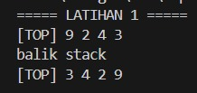
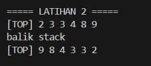
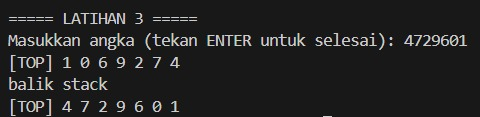

# <h1 align="center">Laporan Praktikum Modul 7 STACK</h1>
<p align="center">MUH. DZAKY LUTHFI - 109082530015</p>

# Dasar Teori

### A. Pengertian Stack
**Stack** (tumpukan) merupakan salah satu bentuk struktur data linier yang menggunakan prinsip operasi seperti tumpukan. Elemen yang bisa diambil terlebih dahulu adalah elemen yang paling atas, atau elemen yang pertama kali masuk. Prinsip ini biasa disebut **LIFO (*Last In First Out*)**. 

Komponen-komponen dalam *stack* pada dasarnya sama dengan komponen pada *Singly Linked List*. Namun, pada *stack* hanya terdapat satu pointer utama yaitu **TOP**, dan akses data hanya bisa dilakukan pada awal *stack* (elemen paling atas) saja. Secara umum, elemen *stack* saling terikat secara linier dengan bantuan pointer, dan elemen terakhir ditandai dengan pointer `next` yang bernilai `Nil`.

### B. Operasi-Operasi dalam Stack
Dalam *stack*, terdapat dua operasi utama, yaitu operasi penyisipan (*Push*) dan operasi pengambilan (*Pop*).

#### 1. Push
*Push* adalah operasi menyisipkan elemen pada tumpukan data. Operasi ini mirip dengan fungsi *insert first* pada list biasa. Langkah-langkah dalam proses *Push* adalah sebagai berikut:
1. Lakukan alokasi memori untuk elemen baru (`P = alokasi(X)`).
2. Set pointer `next` elemen baru menjadi `Nil` (`P->next = Nil`).
3. Arahkan pointer `next` elemen baru ke elemen TOP saat ini (`P->next = S.Top`).
4. Perbarui posisi TOP agar menunjuk ke elemen baru tersebut (`S.Top = P`).

#### 2. Pop
*Pop* adalah operasi pengambilan data dalam list. Operasi ini mirip dengan operasi *delete first* dalam list linear, karena elemen yang paling pertama kali diakses adalah elemen paling atas (TOP). Langkah-langkah dalam proses *Pop* adalah:
1. Simpan elemen TOP saat ini ke dalam variabel penampung (`P = S.Top`).
2. Pindahkan pointer TOP ke elemen di bawahnya (`S.Top = (S.Top)->next`).
3. Kembalikan atau gunakan nilai dari variabel penampung tersebut (`return P`).

### C. Primitif-Primitif dalam Stack
Primitif-primitif dalam *stack* pada dasarnya sama dengan primitif pada list lainnya, namun jumlahnya lebih sedikit karena operasi hanya dilakukan terhadap elemen paling atas. Primitif tersebut antara lain:
1. `createStack()`
2. `isEmpty()`
3. `alokasi()`
4. `dealokasi()`
5. Fungsi-fungsi pencarian
6. Fungsi-fungsi primitif lainnya.

Sama seperti model list lain, primitif-primitif ini disimpan di dalam file `*.c` / `*.cpp` dan file `*.h`.

### D. Stack (Representasi Tabel)
Selain menggunakan *pointer*, *stack* juga dapat direpresentasikan menggunakan **tabel (array)**. Pada prinsipnya, representasi tabel sama dengan representasi pointer, namun perbedaannya terletak pada pendeklarasian struktur data yang menggunakan array berindeks dan jumlah tumpukan yang bersifat terbatas (statis).

Sebagai contoh, sebuah *stack* memiliki kapasitas maksimum pada indeks `Imax = 10`. Stack dikatakan kosong apabila `Top = 0`. 

#### 1. Operasi pada Stack Representasi Tabel
Operasi pada representasi tabel pada dasarnya sama, yaitu *Push* dan *Pop*, namun memanfaatkan pergeseran indeks array:
*   **Push**: Penyisipan data dilakukan dengan cara menggeser indeks `Top` ke indeks berikutnya (`Top = Top + 1`), kemudian data baru disimpan pada indeks `Top` tersebut. Jika `Top` sudah mencapai batas maksimum, maka terjadi kondisi *overflow* (stack penuh).
*   **Pop**: Pengambilan data dilakukan dengan cara menyimpan data pada indeks `Top` saat ini ke dalam variabel penampung (`Temp = S.Info[Top]`), lalu indeks `Top` akan bergeser mundur ke indeks sebelumnya (`Top = Top - 1`). Data lama tidak benar-benar dihapus dari memori array, melainkan hanya diabaikan. Jika `Top = 0`, maka terjadi kondisi *underflow* (stack kosong).

#### 2. ADT Stack Representasi Tabel
Berikut adalah contoh *Abstract Data Type* (ADT) untuk Stack representasi tabel yang dideklarasikan dalam file `stack.h`:

```cpp
/* file : stack.h
   contoh ADT stack dengan representasi tabel */
#ifndef STACK_H_INCLUDED
#define STACK_H_INCLUDED

struct infotype {
    char nim[20];
    char nama[20];
};

struct Stack {
    infotype info[10];
    int Top;
};

/* prototype */
/********* pengecekan apakah Stack kosong *********/
int isEmpty(Stack S);
/* mengembalikan nilai 0 jika stack kosong */

/********* pembuatan Stack *********/
void createStack(Stack &S);
/* I.S. sembarang
   F.S. terbentuk stack dengan Top=0 */

/******** penambahan elemen pada Stack ********/
void push(Stack &S, infotype X);
/* I.S. Stack mungkin kosong
   F.S. menambahkan elemen pada stack dengan nilai X, TOP=TOP+1 */

/******** penghapusan elemen pada list ********/
void pop(Stack &S, infotype &X);
/* I.S. stack tidak kosong
   F.S. nilai info pada indeks TOP disimpan pada X, kemudian TOP=TOP-1 */

/******** proses semua elemen list ********/
void viewStack(Stack S);
/* I.S. stack mungkin kosong
   F.S. jika stack tidak kosong menampilkan semua info yang ada pada stack */

#endif // STACK_H_INCLUDED
```
## Guided 

### 1. Stack.h

```C++
/* file : stack.h
   contoh ADT stack dengan representasi tabel */
#ifndef STACK_H_INCLUDED
#define STACK_H_INCLUDED

#include <iostream>
using namespace std;

struct infotype {
    char nim[20];
    char nama[20];
};
struct Stack {
    infotype info[10];
    int Top;
};

/* prototype */
/******** pengecekan apakah Stack kosong *********/
int isEmpty(Stack S);
/* mengembalikan nilai 0 jika stack kosong */

/******** pembuatan Stack ********/
void createStack(Stack &S);
/* I.S. sembarang
   F.S. terbentuk stack dengan Top=0 */

/******** penambahan elemen pada Stack ********/
void push(Stack &S, infotype X);
/* I.S. Stack mungkin kosong
   F.S. menambahkan elemen pada stack dengan nilai X, TOP=TOP+1 */

/******** penghapusan elemen pada Stack ********/
void pop(Stack &S, infotype &X);
/* I.S. stack tidak kosong
   F.S. nilai info pada indeks TOP disimpan pada X, kemudian TOP=TOP-1 */

/******** proses semua elemen Stack *********/
void viewStack(Stack S);
/* I.S. stack mungkin kosong
   F.S. jika stack tidak kosong menampilkan semua info yang ada pada stack
*/
#endif // STACK_H_INCLUDED
```
Program C++ di atas adalah demo penggunaan Stack dengan data mahasiswa (nim dan nama) dari stack.h, bekerja dengan prinsip LIFO.

Program membuat stack kosong via createStack(S), menampilkan S.Top dan isinya. Lalu push tiga data (Andi, Budi, Citra) dan menampilkan isi stack dengan Citra di posisi teratas. Selanjutnya pop satu data (Citra) dan menampilkan sisa stack. Terakhir, pop sampai kosong tiga kali — aman dari underflow karena pop sudah mengecek isEmpty — lalu menampilkan stack kosong.

### 2. Stack.cpp

```C++
#include "stack.h"

int isEmpty(Stack S) {
    /* Top = 0 berarti kosong, sesuai komentar di stack.h dikembalikan 0 */
    if (S.Top == 0) {
        return 0;
    } else {
        return 1;
    }
}

void createStack(Stack &S) {
    S.Top = 0;
}

void push(Stack &S, infotype X) {
    if (S.Top < 10) {
        S.Top = S.Top + 1;
        S.info[S.Top - 1] = X;   /* Top 1..10 dipetakan ke indeks array 0..9 */
    } else {
        cout << "Stack penuh, data tidak bisa ditambahkan" << endl;
    }
}

void pop(Stack &S, infotype &X) {
    if (isEmpty(S) != 0) {
        X = S.info[S.Top - 1];
        S.Top = S.Top - 1;
    } else {
        cout << "Stack kosong, tidak ada data yang bisa diambil" << endl;
    }
}

void viewStack(Stack S) {
    if (isEmpty(S) == 0) {
        cout << "Stack kosong" << endl;
    } else {
        cout << "Isi stack (dari TOP):" << endl;
        for (int i = S.Top; i >= 1; i--) {
            cout << i << ". " << S.info[i - 1].nim << " - "
                 << S.info[i - 1].nama << endl;
        }
    }
}

```
Kode tersebut merupakan implementasi struktur data Stack (tumpukan) berbasis array statis berkapasitas 10 elemen dengan prinsip LIFO (Last In First Out). Stack menggunakan variabel Top sebagai penanda posisi teratas dengan penomoran 1-based, di mana Top = 0 menandakan kosong dan Top = 10 menandakan penuh. Karena array info tetap menggunakan indeks 0-based, setiap akses data dilakukan melalui rumus info[Top - 1].

Implementasi terdiri dari lima fungsi utama. Fungsi isEmpty mengecek kondisi stack dan mengembalikan nilai 0 jika kosong serta 1 jika tidak kosong — konvensi yang terbalik dari kebiasaan umum. Fungsi createStack menginisialisasi stack kosong dengan mengeset Top = 0. Fungsi push menambahkan elemen ke posisi teratas setelah memastikan Top < 10, dan menampilkan pesan error jika stack penuh untuk mencegah overflow. Fungsi pop mengambil dan menghapus elemen teratas setelah memastikan stack tidak kosong, menyalin data ke variabel X secara by reference lalu mengurangi Top, serta menampilkan pesan error jika kosong untuk mencegah underflow. Fungsi viewStack menampilkan seluruh isi stack dari TOP ke bawah menggunakan perulangan menurun, dengan pesan "Stack kosong" jika tidak ada data.

Secara keseluruhan, implementasi ini sudah lengkap dan aman karena setiap operasi dilengkapi pengecekan batas kapasitas, sehingga terhindar dari overflow maupun underflow, serta konsisten dengan sifat LIFO dalam menampilkan dan mengelola data.


### 3. main.cpp

```C++
#include <iostream>
#include <cstring>
#include "stack.h"
using namespace std;

int main() {
    Stack S;
    infotype data, hasil;

    createStack(S);
    cout << "Stack baru dibuat, Top = " << S.Top << endl;
    viewStack(S);

    cout << endl << "--- Push 3 data ---" << endl;
    strcpy(data.nim, "103112400001");
    strcpy(data.nama, "Andi");
    push(S, data);

    strcpy(data.nim, "103112400002");
    strcpy(data.nama, "Budi");
    push(S, data);

    strcpy(data.nim, "103112400003");
    strcpy(data.nama, "Citra");
    push(S, data);
    viewStack(S);

    cout << endl << "--- Pop 1 data ---" << endl;
    pop(S, hasil);
    cout << "Data yang diambil: " << hasil.nim << " - " << hasil.nama << endl;
    viewStack(S);

    cout << endl << "--- Pop sampai kosong ---" << endl;
    pop(S, hasil);
    pop(S, hasil);
    pop(S, hasil);
    viewStack(S);

    return 0;
}

```
Program C++ tersebut merupakan program demonstrasi struktur data Stack (tumpukan) yang menggunakan implementasi dari file header stack.h. Stack bekerja dengan prinsip LIFO (Last In First Out), yaitu data yang terakhir masuk akan pertama kali keluar.

Program ini menyimpan data mahasiswa bertipe infotype yang terdiri dari field nim dan nama (keduanya berupa array char, sehingga pengisiannya menggunakan strcpy). Variabel S bertipe Stack berfungsi sebagai wadah tumpukan, sedangkan data dan hasil bertipe infotype digunakan sebagai buffer untuk memasukkan dan menampung data hasil operasi.


## Unguided 

## SOAL Modul 7

### 1. Buatlah ADT Stack menggunakan ARRAY sebagai berikut di dalam file “stack.h”:
Type infotype : integer
Type Stack <
info : array [20] of integer
top : integer
>
procedure CreateStack( input/output S : Stack )
procedure push(input/output S : Stack, 
 input x : infotype)
function pop(input/output t S : Stack ) 
→ infotype
procedure printInfo( input S : Stack )
procedure balikStack(input/output S : 
 Stack )
 Buatlah implementasi ADT Stack menggunakan Array pada file “stack.cpp” dan “main.cpp”
```C 
int main()
{
cout << "Hello world!" << 
endl;
Stack S;
createStack(S);
Push(S,3);
Push(S,4);
Push(S,8);
pop(S)
Push(S,2);
Push(S,3);
pop(S);
Push(S,9);
printInfo(S);
cout<<"balik stack"<<endl;
balikStack(S);
printInfo(S);
return 0;
}
```

### 2. Tambahkan prosedur pushAscending( in/out S : Stack, in x : integer)

``` C 
int main()
{
Gambar 7-11 Output stack
STRUKTUR DATA 65
cout << "Hello world!" << endl;
Stack S;
createStack(S);
pushAscending(S,3);
pushAscending(S,4);
pushAscending(S,8);
pushAscending(S,2);
pushAscending(S,3);
pushAscending(S,9);
printInfo(S);
cout<<"balik stack"<<endl;
balikStack(S);
printInfo(S);
return 0;
}
```
### 3. Tambahkan prosedur getInputStream( in/out S : Stack ). Prosedur akan terus membaca dan 
menerima input user dan memasukkan setiap input ke dalam stack hingga user menekan 
tombol enter. Contoh: gunakan cin.get() untuk mendapatkan inputan user.
```C++
int main()
{
cout << "Hello world!" << endl;
Stack S;
createStack(S);
getInputStream(S);
printInfo(S);
cout<<"balik stack"<<endl;
balikStack(S);
printInfo(S);
return 0;
}
```
Jawaban Soal!

```C++
//Stack.h
#ifndef STACK_H_INCLUDED
#define STACK_H_INCLUDED

#include <iostream>
using namespace std;

typedef int infotype;

struct Stack {
    infotype info[20];
    int top;
};

// [1]
void createStack(Stack &S);
bool isEmpty(Stack S);
bool isFull(Stack S);
void push(Stack &S, infotype x);
infotype pop(Stack &S);
void printInfo(Stack S);
void balikStack(Stack &S);

// [2]
void pushAscending(Stack &S, int x);

// [3]
void getInputStream(Stack &S);

#endif // STACK_H_INCLUDED
```

```C++
//Stack.cpp
#include "stack.h"

// [1]
void createStack(Stack &S) {
    S.top = -1;
}

bool isEmpty(Stack S) {
    return (S.top == -1);
}

bool isFull(Stack S) {
    return (S.top == 19);
}

void push(Stack &S, infotype x) {
    if (!isFull(S)) {
        S.top = S.top + 1;
        S.info[S.top] = x;
    }
}

infotype pop(Stack &S) {
    infotype x = -1;
    if (!isEmpty(S)) {
        x = S.info[S.top];
        S.top = S.top - 1;
    }
    return x;
}

void printInfo(Stack S) {
    if (isEmpty(S)) {
        cout << "Stack kosong." << endl;
        return;
    }
    cout << "[TOP] ";
    for (int i = S.top; i >= 0; i--) {
        cout << S.info[i] << " ";
    }
    cout << endl;
}

void balikStack(Stack &S) {
    int arr[20], n = 0;
    while (!isEmpty(S)) {
        arr[n++] = pop(S);
    }
    for (int i = 0; i < n; i++) {
        push(S, arr[i]);
    }
}

// [2]
void pushAscending(Stack &S, int x) {
    Stack temp;
    createStack(temp);

    while (!isEmpty(S) && S.info[S.top] < x) {
        push(temp, pop(S));
    }

    push(S, x);

    while (!isEmpty(temp)) {
        push(S, pop(temp));
    }
}

// [3]
void getInputStream(Stack &S) {
    char c;
    cout << "Masukkan angka (tekan ENTER untuk selesai): ";
    while (cin.get(c) && c != '\n') {
        if (c >= '0' && c <= '9') {
            push(S, c - '0');
        }
    }
}
```

```C++
//main.cpp
#include "stack.h"

int main() {
    // [1]
    cout << "===== LATIHAN 1 =====" << endl;
    Stack S;
    createStack(S);
    push(S, 3);
    push(S, 4);
    push(S, 8);
    pop(S);
    push(S, 2);
    push(S, 3);
    pop(S);
    push(S, 9);
    printInfo(S);
    cout << "balik stack" << endl;
    balikStack(S);
    printInfo(S);

    // [2]
    cout << "\n===== LATIHAN 2 =====" << endl;
    Stack S2;
    createStack(S2);
    pushAscending(S2, 3);
    pushAscending(S2, 4);
    pushAscending(S2, 8);
    pushAscending(S2, 2);
    pushAscending(S2, 3);
    pushAscending(S2, 9);
    printInfo(S2);
    cout << "balik stack" << endl;
    balikStack(S2);
    printInfo(S2);

    // [3]
    cout << "\n===== LATIHAN 3 =====" << endl;
    Stack S3;
    createStack(S3);
    getInputStream(S3);
    printInfo(S3);
    cout << "balik stack" << endl;
    balikStack(S3);
    printInfo(S3);

    return 0;
}
```

### Output Unguided  :

##### Output 1

##### Output 2

##### Output 3



### 1. Pembuatan ADT Dasar dan Insert Data (Soal 1)
Pada tahap ini, fokus utama adalah membangun pondasi struktur data list dan melakukan pengisian data. Program utama (`main.cpp`) diinstruksikan untuk menerima input data buku sebanyak empat kali. Sebelum data benar-benar dimasukkan ke dalam list menggunakan fungsi `insertLast`, program terlebih dahulu memanggil fungsi `findElm`. Fungsi ini berfungsi sebagai pengecekan duplikasi untuk memastikan bahwa `kodeBuku` yang diinput belum ada di dalam list. 

Apabila kode buku yang diinput ternyata sudah terdaftar (seperti pada contoh input ketiga dengan kode B001), program akan menolak input tersebut dan menampilkan pesan peringatan "kode buku sudah terdaftar". Namun, jika kode buku belum ada, program akan memanggil fungsi `alokasi` untuk membuat *node* (simpul) baru, lalu memasukkannya ke bagian akhir list. Setelah seluruh proses input selesai, prosedur `printInfo` dipanggil untuk menampilkan semua data buku yang berhasil tersimpan di dalam list secara berurutan, mulai dari elemen awal (`First`) hingga elemen akhir (`Last`).

### 2. Pencarian Elemen (Soal 2)
Bagian ini menguji fungsionalitas dari fungsi `findElm` yang telah dibuat pada tahap sebelumnya. Program akan meminta pengguna untuk memasukkan kode buku yang ingin dicari (sebagai contoh, pengguna memasukkan B001). 

Fungsi `findElm` akan bekerja dengan menelusuri list mulai dari elemen pertama (`L.First`) menggunakan pointer `next` hingga menemukan *node* yang memiliki atribut `kodeBuku` yang cocok dengan inputan. Jika data yang dicari ditemukan, fungsi akan mengembalikan alamat *node* tersebut, dan program utama akan menampilkan detail informasi buku secara lengkap (Kode Buku, Judul, dan Tahun Terbit). Sebaliknya, jika pencarian mencapai akhir list (`Nil`) dan data tidak ditemukan, program akan menampilkan pesan bahwa data tersebut tidak ada di dalam list.

### 3. Penghapusan Elemen (Soal 3)
Tahap ketiga berfokus pada pengujian prosedur penghapusan data dari dalam list. Program meminta pengguna memasukkan kode buku yang akan dihapus (pada contoh, pengguna memasukkan B003). 

Pertama, program utama akan mencari posisi *node* target tersebut menggunakan fungsi `findElm`. Jika *node* ditemukan, program akan menganalisis posisinya di dalam list. Karena pada contoh B003 berada di tengah list (bukan elemen `First` dan bukan `Last`), program akan mencari *node* tepat sebelum target tersebut (`Prec = targetHapus->prev`). Setelah *node* sebelumnya ditemukan, program memanggil prosedur `deleteAfter`. 

Prosedur `deleteAfter` ini berfungsi untuk memutus rantai hubungan *node* yang akan dihapus dari list. Caranya adalah dengan mengarahkan pointer `next` dari `Prec` melewati target, langsung menuju *node* setelah target. Selain itu, pointer `prev` dari *node* setelah target juga diarahkan kembali ke `Prec`. Setelah *node* target benar-benar terlepas dan tidak lagi terhubung dengan list, memori *node* tersebut dibebaskan menggunakan fungsi `dealokasi`. Sebagai verifikasi akhir, program akan menampilkan kembali isi list (DATA LIST 1) untuk membuktikan bahwa data dengan kode buku B003 sudah berhasil dihapus dan tidak lagi muncul di dalam list.

## Kesimpulan
Berdasarkan praktikum Modul 7 mengenai Stack, dapat disimpulkan bahwa:

Stack merupakan struktur data linier yang menerapkan prinsip LIFO (Last In First Out), di mana elemen yang terakhir dimasukkan (paling atas/TOP) akan menjadi elemen yang pertama kali diambil atau dikeluarkan.

Implementasi Stack dapat direpresentasikan menggunakan dua cara, yaitu menggunakan pointer (Linked List) dan menggunakan tabel/array (statis). Pada representasi tabel, kapasitas stack terbatas dan penggunaan memori lebih sederhana karena tidak memerlukan manajemen alokasi memori dinamis.

Operasi utama pada Stack meliputi Push (menambahkan elemen ke posisi TOP) dan Pop (mengambil dan menghapus elemen dari posisi TOP). Selain itu, terdapat prosedur tambahan seperti printInfo/viewStack (menampilkan data) dan balikStack (membalik urutan stack).

Dalam implementasi Unguided, prosedur pushAscending berhasil dibuat untuk menyisipkan elemen secara terurut, dan prosedur getInputStream berhasil diimplementasikan untuk membaca input karakter dari pengguna secara berurutan hingga menekan tombol Enter.

Setiap operasi pada Stack harus dilengkapi dengan validasi batas (seperti pengecekan isEmpty dan isFull) untuk mencegah terjadinya underflow (pengambilan data saat stack kosong) dan overflow (penambahan data saat stack penuh), sehingga program menjadi lebih aman dan stabil.

## Referensi
[1] Triase. (2020). Diktat Edisi Revisi: STRUKTUR DATA. Medan: Universitas Islam Negeri Sumatera Utara Medan.

[2] Indahyati, Uce., & Rahmawati Yunianita. (2020). BUKU AJAR ALGORITMA DAN PEMROGRAMAN DALAM BAHASA C++. Sidoarjo: Umsida Press. Diakses pada 10 Maret 2024 melalui https://doi.org/10.21070/2020/978-623-6833-67-4

[3] Modul Praktikum 7: Stack. Laboratorium Struktur Data. Fakultas Informatika, Universitas Telkom.


<br>...
